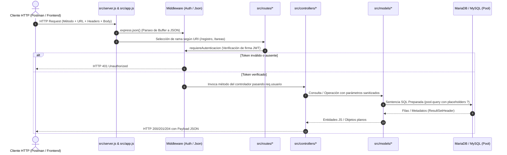

# Arquitectura y Funcionamiento Integral del Sistema de Gestión de Tareas


**Tema:** Desarrollo Backend y Arquitectura de APIs RESTful  
**Tecnologías:** Node.js (v22+), Express.js, MySQL / MariaDB, JSON Web Tokens (JWT), Bcrypt, SQL Relacional  
**Paradigma:** Arquitectura en Capas (Layered Architecture) basada en el patrón Modelo-Vista-Controlador (MVC sin Vistas acopladas — API RESTful Stateless)  
**Autor:** Pablo Martín Bejas  
**Website:** [pablobejas.vercel.app](https://pablobejas.vercel.app)  


## Índice General

1. [Introducción y Fundamentos Arquitectónicos](#1-introducción-y-fundamentos-arquitectónicos)
2. [Estructura del Proyecto y Flujo de Datos (Request Lifecycle)](#2-estructura-del-proyecto-y-flujo-de-datos-request-lifecycle)
3. [Entorno y Gestión de Dependencias](#3-entorno-y-gestión-de-dependencias)
   - [3.1 `package.json`](#31-packagejson)
   - [3.2 `.env`](#32-env)
4. [Capa de Persistencia y Modelado de Datos](#4-capa-de-persistencia-y-modelado-de-datos)
   - [4.1 `database/schema.sql`](#41-databaseschemasql)
   - [4.2 `src/config/db.js`](#42-srcconfigdbjs)
5. [Capa de Acceso a Datos (Modelos / DAO)](#5-capa-de-acceso-a-datos-modelos--dao)
   - [5.1 `src/models/usuarios.model.js`](#51-srcmodelsusuariosmodeljs)
   - [5.2 `src/models/tareas.model.js`](#52-srcmodelstareasmodeljs)
   - [5.3 Debate Arquitectónico: ¿Por qué `models/` y no `services/`? (Model vs. Service vs. Repository/DAO)](#53-debate-arquitectónico-por-qué-models-y-no-services-model-vs-service-vs-repositorydao)
6. [Capa de Interceptación y Control de Acceso (Middlewares)](#6-capa-de-interceptación-y-control-de-acceso-middlewares)
   - [6.1 `src/middlewares/requiereAutenticacion.js`](#61-srcmiddlewaresrequiereautenticacionjs)
   - [6.2 `src/middlewares/manejarErrores.js`](#62-srcmiddlewaresmanejarerroresjs)
7. [Capa de Lógica de Negocio y Control (Controladores)](#7-capa-de-lógica-de-negocio-y-control-controladores)
   - [7.1 `src/controllers/auth.controller.js`](#71-srccontrollersauthcontrollerjs)
   - [7.2 `src/controllers/tareas.controller.js`](#72-srccontrollerstareascontrollerjs)
8. [Capa de Enrutamiento (Routers)](#8-capa-de-enrutamiento-routers)
   - [8.1 `src/routes/auth.routes.js`](#81-srcroutesauthroutesjs)
   - [8.2 `src/routes/tareas.routes.js`](#82-srcroutestareasroutesjs)
9. [Núcleo y Punto de Entrada de la Aplicación](#9-núcleo-y-punto-de-entrada-de-la-aplicación)
   - [9.1 `src/app.js`](#91-srcappjs)
   - [9.2 `src/server.js`](#92-srcserverjs)
10. [Análisis de Seguridad y Buenas Prácticas Computacionales](#10-análisis-de-seguridad-y-buenas-prácticas-computacionales)
11. [Guía Práctica de Pruebas con Postman y Clientes HTTP](#11-guía-práctica-de-pruebas-con-postman-y-clientes-http)
12. [Síntesis Arquitectónica y Balance Integral del Sistema](#12-síntesis-arquitectónica-y-balance-integral-del-sistema)
13. [Anexo: Código Fuente Completo y Guía de Despliegue Rápido](#13-anexo-código-fuente-completo-y-guía-de-despliegue-rápido)


## 1. Introducción y Fundamentos Arquitectónicos

### Más Allá de un Gestor de Tareas: La Anatomía de un Backend Profesional

En el aprendizaje de las ciencias de la computación y el desarrollo web, la creación de una aplicación de tareas (*To-Do List*) suele presentarse con frecuencia como un ejercicio elemental o un simple "proyecto introductorio". Sin embargo, existe un abismo de ingeniería entre un script improvisado que simplemente "funciona" en una máquina local y un **sistema backend robusto, seguro, escalable y mantenible**, diseñado bajo los rigurosos estándares que exige la industria del software contemporáneo.

Este proyecto toma ese problema fundacional del dominio del desarrollo (la gestión concurrente y multiusuario de información) y lo transforma en un **laboratorio de alta fidelidad arquitectónica**. Aquí, cada línea de código, cada directiva SQL y cada cabecera HTTP responde a una decisión técnica deliberada, demostrando cómo se articulan las piezas de una infraestructura moderna sin recurrir a "magias" de frameworks pesados que oculten la realidad del protocolo.

```
       ┌────────────────────────────────────────────────────────┐
       │             LA FILOSOFÍA DE NUESTRA ARQUITECTURA       │
       ├────────────────────────────────────────────────────────┤
       │ 1. Transparencia: Entender cómo viaja cada byte de red.│
       │ 2. Desacoplamiento: Ninguna capa sabe de más.          │
       │ 3. Resiliencia: La aplicación falla rápido y seguro.   │
       │ 4. Soberanía: El servidor no guarda sesiones en RAM.   │
       └────────────────────────────────────────────────────────┘
```


### Los Pilares Fundamentales del Diseño

La arquitectura de este sistema se asienta sobre cinco principios de ingeniería que guían su comportamiento de punta a punta:

#### 1. Separación de Responsabilidades (*Separation of Concerns - SoC*)
La premisa central es la claridad absoluta de roles. El software está estructurado como una línea de ensamblaje de alta precisión:
* Los **Enrutadores** solo saben clasificar y derivar tráfico de red.
* Los **Middlewares** actúan como aduanas perimetrales e interceptores de control.
* Los **Controladores** orquestan la lógica del negocio y formulan respuestas semánticas.
* Los **Modelos** administran el acceso a los datos y hablan el lenguaje de MySQL.
* El **Pool de Conexiones** gestiona eficientemente la apertura física de canales de red.
Ningún componente invade el territorio funcional de otro. Si mañana cambia la estructura de las tablas en la base de datos, los controladores no sufren alteraciones; si cambia el diseño de las rutas web, los modelos permanecen intactos.

#### 2. Bajo Acoplamiento y Alta Cohesión (*The Symphony of Decoupling*)
Los módulos de la aplicación interactúan mediante contratos de interfaz limpios y previsibles:
* La capa de acceso a datos **no sabe qué es una petición HTTP** (no manipula objetos `req` ni `res`, ni sabe qué es una cabecera de navegador).
* La capa de controladores **no sabe escribir sentencias SQL** (no conoce sintaxis `SELECT` o `INSERT`, delegando en métodos con nombres semánticos de dominio como `Tareas.crear`).
Esto permite que cada pieza pueda probarse, refactorizarse, aislarse o sustituirse con mínimo impacto colateral.

#### 3. Arquitectura REST Stateless (Escalabilidad sin Memoria de Servidor)
En los sistemas web tradicionales del pasado, el servidor mantenía "sesiones" en su memoria RAM local para recordar quién estaba conectado. Si el servidor se reiniciaba o si entraban 100.000 usuarios en simultáneo, la memoria colapsaba.
Este proyecto abraza la naturaleza **Stateless (Sin Estado)** del protocolo HTTP según los principios de Roy Fielding: el servidor no almacena sesiones en memoria. Cada petición entrante es **autónoma, soberana y autocontenida**, portando en sus cabeceras su propia credencial de identidad criptográfica mediante un **JSON Web Token (JWT)** firmado digitalmente. Esto permite que el backend pueda clonarse y balancearse en decenas de servidores en la nube sin requerir sincronización de memoria entre ellos.

#### 4. Adopción Estricta de Módulos ECMAScript Nativos (*ESM*)
El proyecto prescinde del ecosistema anticuado CommonJS (`require()` y `module.exports`) y adopta la especificación moderna de JavaScript (`import` y `export`). Esto no solo alinea el código con los estándares internacionales de ECMAScript, sino que habilita características de vanguardia del motor V8 de Node.js, como el análisis estático de dependencias, la optimización de árboles de importación (*tree shaking*) y la ejecución de **Top-Level `await`** directamente en el cuerpo raíz de los módulos.

#### 5. Seguridad por Diseño (*Security by Design*)
En este desarrollo, la seguridad no es un apósito superficial colocado a las apuradas antes de entregar; es una propiedad emergente de la propia arquitectura:
* **Inmunidad criptográfica** ante ataques de inyección SQL mediante sentencias preparadas obligatorias.
* **Resistencia temporal** contra ataques de fuerza bruta en contraseñas mediante el factor de coste computacional de Bcrypt ($2^{10}$ iteraciones).
* **Hermetismo contra fugas de información** (*Information Disclosure*) mediante la supresión de trazas internas en el manejador global de errores.
* **Control de acceso bidimensional** en base de datos para neutralizar completamente los ataques de manipulación de identidades (IDOR).

El presente documento constituye un **recorrido analítico, didáctico y exhaustivo** por cada módulo del sistema, pensado para que el lector descubra no solo *cómo* está escrito el código, sino las profundas razones de ingeniería informática que justifican cada decisión técnica.


## 2. Estructura del Proyecto y Flujo de Datos (Request Lifecycle)

### Diagrama del Ciclo de Vida de una Petición (Request-Response)



### Explicación Paso a Paso del Flujo de Datos (Request-Response Lifecycle)

El diagrama de secuencia anterior ilustra el **viaje completo de ida y vuelta** que realiza una petición informática desde que un usuario presiona un botón en el cliente hasta que la base de datos se actualiza y el servidor devuelve una respuesta formal.

A continuación se detalla qué ocurre en cada una de las estaciones de este circuito:

#### 1. Emisión de la Petición HTTP (`Cliente ──► Server`)

El cliente (ya sea un navegador con React/Vue, una app móvil en Flutter o una herramienta de pruebas como Postman) empaqueta el mensaje en el protocolo HTTP y lo envía a través del socket de red hacia el puerto 3000 de nuestro servidor backend.

El paquete contiene cuatro elementos cardinales:
1. **El Método:** La acción semántica deseada (`GET`, `POST`, `PATCH`, `DELETE`).
2. **La URL:** El recurso solicitado (p. ej., `/tareas`).
3. **Las Cabeceras (Headers):** Metadatos de control, destacando `Content-Type: application/json` y `Authorization: Bearer <token_jwt>`.
4. **El Cuerpo (Body):** La carga útil con los datos en formato texto JSON (p. ej., `{"texto": "Comprar pan"}`).

#### 2. Deserialización del Flujo Binario (`Server ──► Middleware: express.json()`)

A nivel físico de red, los datos no viajan como objetos de programación, sino como una corriente continua de bytes binarios (*stream de TCP*).

El middleware global `express.json()` intercepta estos fragmentos (*chunks*), los ensambla en memoria, ejecuta internamente `JSON.parse()` y deposita el objeto JavaScript resultante en `req.body`, dejándolo listo para ser consumido por las siguientes capas.

#### 3. Conmutación de Rutas (`Server ──► Router`)

El núcleo de la aplicación ([`src/app.js`](file:///c:/Users/Pablo%20Bejas/Desktop/Programacion%204/src/app.js)) examina el prefijo del camino de la URL. Si la ruta comienza con `/tareas`, Express conmuta el tráfico y deriva la responsabilidad al enrutador modular especializado ([`src/routes/tareas.routes.js`](file:///c:/Users/Pablo%20Bejas/Desktop/Programacion%204/src/routes/tareas.routes.js)).

#### 4. Aduana de Seguridad Perimetral (`Router ──► Middleware: requiereAutenticacion`)

Antes de que la petición toque cualquier controlador de tareas, se estrella contra la barrera perimetral impuesta por `router.use(requiereAutenticacion)`. Este guardián extrae el token JWT de la cabecera `Authorization` y verifica matemáticamente su firma digital HMAC-SHA256 utilizando la clave secreta `JWT_SECRET`.

#### 5. La Bifurcación Crítica (`alt`)

**Camino de Rechazo (Token ausente, inválido o manipulado):**  
Si el cliente no envió el token, si el token ya expiró (más de 24 horas) o si un atacante alteró su contenido, el middleware corta el flujo de inmediato y responde al cliente `HTTP 401 Unauthorized`.  
*Principio de Aislamiento:* La petición muere aquí. Jamás llega a los controladores ni a los modelos, evitando que código no autorizado consuma ciclos de CPU o acceda a la base de datos.

**Camino Exitoso (Token verificado legítimamente):**  
Si la firma es auténtica, el middleware decodifica el payload y lo inyecta directamente en la petición:
```javascript
req.usuario = { id: payload.id, email: payload.email };
```
Acto seguido invoca `next()`, permitiendo que la petición avance con la identidad del usuario certificada.

#### 6. Orquestación y Lógica de Negocio (`Middleware ──► Controller`)

El router despacha la petición hacia la función controladora correspondiente según el método HTTP (p. ej., `POST /tareas` invoca a `controlador.crear`).

El controlador ejecuta las reglas del negocio:
1. Valida la presencia y formato de los datos (`if (!texto || !texto.trim())`).
2. Sanitiza la entrada removiendo espacios residuales (`texto.trim()`).
3. Prepara la llamada a la capa de persistencia asociando la tarea con el ID auténtico del usuario (`req.usuario.id`).

#### 7. Abstracción del Acceso a Datos (`Controller ──► Model`)

El controlador no escribe consultas SQL: delega la persistencia en el modelo correspondiente ([`src/models/tareas.model.js`](file:///c:/Users/Pablo%20Bejas/Desktop/Programacion%204/src/models/tareas.model.js)) invocando métodos con nombres semánticos de dominio (`Tareas.crear(...)`, `Tareas.listarPorUsuario(...)`).

#### 8. Ejecución Protegida en Base de Datos (`Model ──► DB`)

El modelo toma una conexión disponible del **Pool de MySQL** y despacha una **Sentencia Preparada (*Prepared Statement*)** con marcadores de posición `?`:
```sql
INSERT INTO tareas (texto, usuario_id) VALUES (?, ?)
```
El motor relacional compila la estructura sintáctica de la consulta de forma aislada a los datos, garantizando inmunidad absoluta contra inyecciones SQL.

#### 9. Persistencia Física y Respuesta de MySQL (`DB ──► Model`)

El motor de almacenamiento de MySQL (InnoDB) escribe los registros en disco, garantiza la durabilidad de la transacción y devuelve al driver de Node.js un paquete con los metadatos de la operación (`ResultSetHeader` con el `insertId` autoincremental generado).

#### 10. Mapeo y Normalización de Entidades (`Model ──► Controller`)

El modelo transforma la respuesta cruda de la base de datos en un objeto limpio de JavaScript (por ejemplo, asegurando que el entero `0` o `1` de MySQL sea transformado a un booleano estricto `true` o `false` mediante `aBooleano`) y lo retorna al controlador.

#### 11. Emisión de la Respuesta Semántica (`Controller ──► Cliente`)

El controlador elige el código de estado HTTP estándar según RFC 9110:
* `201 Created` con el objeto recién creado en `POST`.
* `200 OK` con los datos recuperados en `GET` o `{ ok: true }` en `PATCH`.
* `204 No Content` con cuerpo vacío en `DELETE`.

Express convierte el objeto a texto JSON, fija las cabeceras HTTP de respuesta y despacha el paquete a través del socket de red de regreso al cliente, cerrando de forma exitosa y limpia el ciclo de vida de la petición.


## 3. Entorno y Gestión de Dependencias

### Introducción Conceptual: El Manifiesto y la Caja Fuerte del Proyecto

Antes de redactar la primera línea de lógica de negocio o diseñar las rutas de una API, todo sistema de software profesional debe resolver dos desafíos estructurales fundamentales:
1. **¿Qué herramientas y librerías externas necesita la aplicación para funcionar?** (Gestión de Dependencias).
2. **¿En qué contexto operativo se ejecuta y dónde se resguardan sus secretos?** (Gestión de Entorno y Configuración).

En el ecosistema moderno de Node.js, estos dos pilares se materializan a través de dos archivos complementarios: **`package.json`** y **`.env`**.

```
  ┌──────────────────────────────────────────────────────────────┐
  │                        package.json                          │
  │                  (EL MANIFIESTO PÚBLICO)                     │
  │  - Qué librerías utiliza el proyecto (Express, MySQL2, etc.).│
  │  - Qué comandos existen para ejecutarlo (npm start, dev).    │
  │  - Es público y SE COMPARTE en el repositorio Git.           │
  └──────────────────────────────┬───────────────────────────────┘
                                 │
                                 ▼  (Trabajan en conjunto)
  ┌──────────────────────────────────────────────────────────────┐
  │                            .env                              │
  │                   (LA CAJA FUERTE PRIVADA)                   │
  │  - Secretos, credenciales de base de datos y llaves JWT.     │
  │  - Varía según la máquina (desarrollo, testing, producción). │
  │  - Es estrictamente confidencial y NUNCA se sube a Git.      │
  └──────────────────────────────────────────────────────────────┘
```

#### 1. Analogía Cotidiana: La Cocina de un Restaurante

Imagina la puesta en marcha de un restaurante de alta cocina:

**El archivo `package.json` es el manual de equipamiento e insumos de la cocina:** detalla qué tipo de hornos, cuchillos, sartenes y materias primas deben adquirirse a proveedores externos para que la cocina pueda operar (las dependencias), y qué procedimientos debe seguir la brigada para abrir y cerrar el local cada día (los scripts). Este manual es genérico y puede entregarse a cualquier cocinero para que monte una cocina idéntica en otra sucursal.

**El archivo `.env` es la caja fuerte personal del dueño del local:** contiene las llaves maestras de la puerta, la combinación de la alarma de seguridad, la clave bancaria para cobrar a clientes y la dirección física exacta de esa sucursal en particular. Si abres una segunda sucursal en otra ciudad, la cocina usará exactamente el mismo manual de equipamiento (`package.json`), pero tendrá su propia caja fuerte con combinaciones y direcciones distintas (`.env`). Jamás pegarías la combinación de la caja fuerte en el menú visible para los clientes.

#### 2. `package.json`: El Documento de Identidad del Software

El archivo `package.json` es el corazón administrativo de cualquier desarrollo en Node.js. Cumple tres funciones vitales:

**Identidad y Configuración del Lenguaje:** Define el nombre del paquete, la versión semántica y, crucialmente, la directiva `"type": "module"`, que le ordena al motor V8 de Node.js interpretar el código bajo la especificación moderna **ECMAScript Modules (ESM)**, habilitando `import`/`export` y *Top-Level `await`*.

**Gestión Jerárquica de Dependencias:** Diferencia con precisión entre dependencias de producción (`dependencies`), paquetes imprescindibles para que la API atienda clientes en el mundo real (como `express`, `mysql2` o `bcryptjs`), y dependencias de desarrollo (`devDependencies`), herramientas auxiliares como `nodemon`, que facilitan la vida del programador reiniciando el servidor automáticamente ante cambios de código, pero que no deben consumir recursos ni memoria en un servidor productivo final.

**Automatización del Ciclo de Vida (`scripts`):** Centraliza los comandos operativos del equipo (`npm start` para encendido estándar y `npm run dev` para desarrollo activo), permitiendo que cualquier desarrollador o tubería de integración continua (CI/CD) ejecute la aplicación sin conocer los comandos internos del sistema operativo.

#### 3. `.env`: La Muralla de Seguridad y la Portabilidad (Metodología The Twelve-Factor App)

El archivo `.env` materializa el tercer principio de la metodología de ingeniería de software moderna conocida como **The Twelve-Factor App (Las 12 Reglas de las Aplicaciones Nativas en Nube): "Configuración estricta en el entorno"**.

Su presencia obedece a dos imperativos categóricos de la industria:

**Seguridad Absoluta (Prevención de Fuga de Credenciales):**  
Si un desarrollador comete el grave error de escribir la contraseña de MySQL o el secreto de JWT directamente dentro del código JavaScript (por ejemplo: `const password = "MiPassword123*"` en `db.js`), en el instante en que ese archivo se suba a GitHub o GitLab, las credenciales quedarán expuestas públicamente. En Internet operan miles de bots maliciosos que rastrean repositorios en tiempo real buscando palabras clave como `DB_PASSWORD` para secuestrar servidores en cuestión de segundos. Al colocar los secretos en `.env` y agregarlo al archivo `.gitignore`, garantizamos que las claves jamás abandonen la computadora local.

**Portabilidad Universal (Software Agnóstico a la Infraestructura):**  
El código de una aplicación profesional debe ser idéntico e inmutable en cualquier entorno. Si el servidor corre en tu computadora local, la base de datos estará en `localhost:3306`; si corre en un entorno de pruebas, estará en un contenedor Docker; y si corre en producción, residirá en un clúster administrado en AWS o Google Cloud. Gracias a `.env`, el código fuente no se modifica jamás: solo cambian los valores inyectados por el entorno operativo.

Ambos archivos trabajan en perfecta sinergia: `package.json` declara la dependencia `dotenv`, y la librería `dotenv` es la encargada de leer el archivo físico `.env` al arrancar el servidor para poblar el objeto global `process.env`.


### 3.1 `package.json`

#### Código:
```json
{
  "name": "proyecto-tareas",
  "version": "1.0.0",
  "description": "API de gestión de tareas con Express y MySQL",
  "type": "module",
  "main": "src/server.js",
  "scripts": {
    "start": "node src/server.js",
    "dev": "nodemon src/server.js"
  },
  "dependencies": {
    "bcryptjs": "^2.4.3",
    "dotenv": "^16.4.7",
    "express": "^4.21.2",
    "jsonwebtoken": "^9.0.2",
    "mysql2": "^3.12.0"
  },
  "devDependencies": {
    "nodemon": "^3.1.9"
  }
}
```

#### Explicación Teórica y Conceptual:

**`"type": "module"`:**  
Declara formalmente que todos los archivos `.js` de este paquete deben ser interpretados por Node.js bajo la especificación **ECMAScript Modules (ESM)**. Esto habilita las directivas `import` / `export` y características avanzadas como *Top-Level `await`* en módulos raíz sin necesidad de envoltorios auto-ejecutables `(async () => { ... })()`.

**`"scripts"` (Automatización del ciclo de vida):**
* `npm start`: Modo producción estándar, invocando el binario nativo de Node.js.
* `npm run dev`: Modo desarrollo mediante `nodemon`, que establece un observador del sistema de archivos (*file watcher*) que reinicia automáticamente el proceso de Node.js ante modificaciones en el código fuente.

**`dependencies` (Librerías de Producción):**
* **`express`:** Framework minimalista para la gestión de servidores HTTP, enrutamiento semántico y composición de tuberías de middlewares (*middleware pipeline*).
* **`mysql2`:** Controlador optimizado para MySQL y MariaDB que ofrece soporte de sentencias preparadas nativas y una interfaz basada en promesas (`mysql2/promise`).
* **`bcryptjs`:** Implementación pura de JavaScript del algoritmo de cifrado adaptativo de hashing *bcrypt*, basado en el cifrador de bloques *Blowfish*.
* **`jsonwebtoken`:** Implementación de la norma **RFC 7519** para emisión y verificación criptográfica de tokens compactos y seguros.
* **`dotenv`:** Módulo que implementa el principio III del manifiesto *The Twelve-Factor App* (almacenar la configuración en el entorno), inyectando pares clave-valor de un archivo `.env` en el objeto global `process.env`.

**`devDependencies` (Herramientas de Desarrollo):**
* **`nodemon`:** Monitor de desarrollo que reinicia el servidor Node.js en milisegundos ante cualquier cambio guardado en el código fuente.


### 3.2 `.env`

#### Código:
```env
PORT=3000
JWT_SECRET=GataPequeñaPelusa1846*

DB_HOST=localhost
DB_PORT=3306
DB_USER=tareas_app
DB_PASSWORD=Pablo+2016*
DB_NAME=tareas_db
```

#### Explicación Teórica y Conceptual:

**Separación de Configuración y Código Fuente:**  
Almacenar credenciales dentro del código es una vulnerabilidad crítica (OWASP A07:2021 - Fallas de Identificación y Autenticación). El archivo `.env` se excluye del control de versiones mediante `.gitignore`.

**`PORT`:**  
Especifica el puerto TCP en el cual el socket del servidor Express permanecerá en estado de escucha (*LISTEN*).

**`JWT_SECRET`:**  
Clave simétrica o secreto criptográfico con el cual se firma el hash HMAC-SHA256 del token JWT. Una longitud y entropía adecuadas garantizan inmunidad contra ataques de diccionario y colisión criptográfica.

**Parámetros de Base de Datos (`DB_*`):**  
Permiten que el software sea agnóstico a la infraestructura (el mismo código se ejecuta en desarrollo local, entornos de prueba o contenedores en la nube variando únicamente las variables de entorno).


## 4. Capa de Persistencia y Modelado de Datos

### Introducción Conceptual a la Capa de Persistencia

En la arquitectura de sistemas informáticos, la **Capa de Persistencia** es el subsistema encargado de trasladar los datos volátiles que residen temporalmente en la memoria de trabajo (RAM) hacia un medio de almacenamiento no volátil y permanente (como discos de estado sólido o magnéticos gestionados por un motor relacional como MySQL o MariaDB).

```
  ┌──────────────────────────────────────────────────────────────┐
  │                 MEMORIA VOLÁTIL (RAM)                        │
  │  - Proceso Node.js / Express en ejecución.                   │
  │  - Si el servidor se apaga, se reinicia o sufre un corte de │
  │    energía, TODO lo que esté en memoria RAM SE PIERDE.       │
  └──────────────────────────────┬───────────────────────────────┘
                                 │
                                 ▼  (Capa de Persistencia: SQL DML)
  ┌──────────────────────────────────────────────────────────────┐
  │              ALMACENAMIENTO PERMANENTE (DISCO)               │
  │  - Motor MySQL / MariaDB (Motor InnoDB).                    │
  │  - Los registros sobreviven a reinicios, cortes y fallas.    │
  │  - Garantía de Durabilidad (el principio "D" de ACID).       │
  └──────────────────────────────────────────────────────────────┘
```

#### 1. Analogía Didáctica: La Pizarra Blanca vs. El Libro Contable Grabado en Papel
Imagina la oficina de un contador:
* La **memoria RAM** de Node.js es como una **pizarra blanca con marcador al agua**. El contador puede anotar cálculos rápidos en la pizarra, pero si alguien pasa con un borrador o si se apaga la luz del edificio por la noche, las notas se desvanecen por completo.
* Si un sistema backend almacenara los usuarios y las tareas en un simple array de JavaScript en memoria (`const tareas = []`), en cuanto el desarrollador reinicie el servidor con `nodemon` para aplicar un cambio de código, ¡todas las tareas de todos los clientes desaparecerían instantáneamente!
* La **Capa de Persistencia** es el **libro contable oficial encuadernado y escrito con tinta indeleble**. Aunque la oficina se quede sin luz, el libro sigue intacto en el estante. MySQL es ese libro contable: garantiza que los datos perduren a lo largo del tiempo (*persistencia de datos*).

#### 2. Requisito Operativo Mandatorio: La Base de Datos y las Tablas NO se Crean Solas
Un error conceptual frecuente en quienes se inician en el desarrollo backend es suponer que al ejecutar `npm run dev` o `node src/server.js`, Node.js creará la base de datos y las tablas de forma automática o mágica en la computadora.

**En arquitecturas con SQL relacional puro y driver nativo (`mysql2`), esto NO ocurre:**
* Node.js y Express son simplemente el motor que procesa la lógica del negocio; **no son el motor de base de datos**.
* El driver `mysql2` solo sabe enviar órdenes SQL a través de un canal de red; no crea estructuras si no se lo ordenas explícitamente.
* **Condición de Funcionamiento Obligatoria:** Para que el proyecto funcione en cualquier entorno o máquina nueva, **el motor de base de datos (MySQL Server o MariaDB) debe estar previamente encendido y las tablas deben haber sido creadas de antemano mediante el script SQL**.

#### ¿Qué sucede si inicias el backend sin haber creado la base o las tablas?
1. **Si no creaste la base de datos `tareas_db`:**
   Al intentar conectar, el pool fallará con el error nativo:
   `Error: ER_BAD_DB_ERROR: Unknown database 'tareas_db'`
2. **Si creaste la base pero olvidaste crear las tablas `usuarios` o `tareas`:**
   El servidor arrancará, pero en cuanto el primer usuario intente registrarse o listar tareas, la consulta colapsará con el error:
   `Error: ER_NO_SUCH_TABLE: Table 'tareas_db.usuarios' doesn't exist`
3. **El Mecanismo de Defensa Fail-Fast:**
   Gracias a que en [`src/server.js`](file:///c:/Users/Pablo%20Bejas/Desktop/Programacion%204/src/server.js) implementamos `await probarConexion()`, el servidor verifica la existencia y conectividad de MySQL antes de abrir el puerto HTTP. Si la base no responde, el servidor aborta inmediatamente con `process.exit(1)`, protegiendo al sistema de operar en un estado zombi o inconsistente.

Por esta razón, el archivo [`database/schema.sql`](file:///c:/Users/Pablo%20Bejas/Desktop/Programacion%204/database/schema.sql) es la **piedra fundacional** sobre la cual se edifica todo el resto de la aplicación.


### 4.1 `database/schema.sql`

#### Código:
```sql
CREATE DATABASE IF NOT EXISTS tareas_db
  CHARACTER SET utf8mb4 COLLATE utf8mb4_unicode_ci;

USE tareas_db;

CREATE TABLE IF NOT EXISTS usuarios (
  id INT AUTO_INCREMENT PRIMARY KEY,
  email VARCHAR(255) NOT NULL UNIQUE,
  password_hash VARCHAR(255) NOT NULL,
  creado_en TIMESTAMP DEFAULT CURRENT_TIMESTAMP
);

CREATE TABLE IF NOT EXISTS tareas (
  id INT AUTO_INCREMENT PRIMARY KEY,
  texto VARCHAR(500) NOT NULL,
  completada BOOLEAN NOT NULL DEFAULT FALSE,
  usuario_id INT NOT NULL,
  creado_en TIMESTAMP DEFAULT CURRENT_TIMESTAMP,
  FOREIGN KEY (usuario_id) REFERENCES usuarios(id) ON DELETE CASCADE
);
```

#### Explicación Teórica y Conceptual:

**Codificación `utf8mb4`:**  
A diferencia de `utf8` estándar de MySQL (que históricamente solo soportaba hasta 3 bytes), `utf8mb4` implementa el estándar completo UTF-8 de 4 bytes, permitiendo caracteres multibyte internacionales y emojis sin pérdida de datos.

**Normalización y Relaciones (1:N):**  
Un usuario puede ser titular de cero, una o múltiples tareas. Cada tarea pertenece de forma estricta y obligatoria a un único usuario (`usuario_id INT NOT NULL`).

**Integridad Referencial y `ON DELETE CASCADE`:**  
La restricción de clave externa (`FOREIGN KEY`) asegura que no existan tareas huérfanas en el sistema. La cláusula `ON DELETE CASCADE` garantiza la consistencia transaccional automática: si un registro en la tabla `usuarios` es eliminado, el motor de base de datos borra inmediatamente todas las tareas vinculadas a dicho `id` de forma atómica.

**Campos Notables:**
* `email VARCHAR(255) UNIQUE`: Crea un índice B-Tree único que impide a nivel de motor relacional registros duplicados con complejidad temporal $O(\log n)$.
* `password_hash VARCHAR(255)`: Aloja la cadena producida por bcrypt (típicamente 60 caracteres; margen de 255 para algoritmos futuros).
* `completada BOOLEAN`: En MySQL/MariaDB es un sinónimo de `TINYINT(1)`, donde `0` representa falso y `1` verdadero.


### 4.2 `src/config/db.js`

#### Código:
```javascript
import mysql from 'mysql2/promise';

export const pool = mysql.createPool({
  host: process.env.DB_HOST,
  port: Number(process.env.DB_PORT) || 3306,
  user: process.env.DB_USER,
  password: process.env.DB_PASSWORD,
  database: process.env.DB_NAME,
  waitForConnections: true,
  connectionLimit: 10,
});

export async function probarConexion() {
  const [filas] = await pool.query('SELECT 1 + 1 AS resultado');
  console.log('Conectado a MySQL — 1 + 1 =', filas[0].resultado);
}
```

#### Explicación Teórica y Conceptual:

##### 1. Patrón Connection Pool (Grupo de Conexiones)

**¿Qué problema resuelve? (El costo de conectar y desconectar cada vez):**  
Node.js y MySQL son dos programas independientes (muchas veces en servidores distintos). Para comunicarse, tienen que "hacer una llamada telefónica". Si no usamos un Pool, cada vez que un usuario hace una consulta en la aplicación ocurre todo este proceso:

1. **Saludo inicial de red (*Handshake TCP*):** No pueden mandarse datos de golpe. Primero coordinan la conexión en 3 pasos (Node pregunta *"¿Estás ahí?"* $\to$ MySQL responde *"Sí, ¿tú me escuchas?"* $\to$ Node confirma *"Sí, empezamos"*). Cada mensaje viaja por la red (ida y vuelta), sumando tiempo de espera.
2. **Seguridad y Cifrado (*Negociación TLS/SSL*):** Si la conexión viaja cifrada para proteger los datos, ambos servidores deben ponerse de acuerdo primero en la clave secreta que usarán para que nadie pueda espiar la comunicación.
3. **Identificación y Permisos (*Autenticación MySQL*):** Node.js debe presentarse con usuario, contraseña y base de datos (`tareas_db`). MySQL verifica la clave y le da acceso.
4. **Consumo de memoria en MySQL:** Por cada cliente nuevo que se conecta, el servidor MySQL debe asignar un hilo exclusivo (*thread*) de procesamiento y un bloque de memoria RAM para atenderlo.
5. **La consulta real:** Recién en este punto se ejecuta la orden SQL (por ejemplo, buscar un usuario), lo cual a MySQL le toma apenas **1 o 2 milisegundos**.
6. **Despedida y Cierre:** Se deben despedir formalmente para cerrar el canal de comunicación.

> **La paradoja:** Cumplir con todo el "papeleo" y la burocracia previa de conectarse toma entre **50 ms y 200 ms**, mientras que la consulta en sí solo dura **2 ms**. Es como viajar 1 hora en colectivo solo para comprar un chicle. Peor aún: si entran 100 usuarios al mismo tiempo, MySQL colapsa por intentar abrir 100 conexiones simultáneas y quedarse sin memoria.

**¿Cómo funciona el Connection Pool para solucionarlo?**  
En vez de abrir y cerrar conexiones a cada rato, el Pool crea y mantiene un conjunto fijo de conexiones (por ejemplo, 10) **abiertas, autenticadas y listas para usar desde el inicio**:
* **Piscina Libre (*Idle*):** Conexiones que están conectadas esperando que alguien las use.
* **Piscina Ocupada (*Busy*):** Conexiones que están respondiendo una consulta en este instante.
* **Fila de espera (*Cola*):** Consultas que llegaron cuando las 10 conexiones estaban ocupadas.

**Paso a paso de una consulta con el Pool:**
1. **Pedir una conexión:** Cuando tu código hace una consulta (p. ej. `pool.query()`), le pide al Pool una conexión que esté desocupada.
2. **Aprovechar la llamada ya abierta:** Como la conexión ya hizo el saludo y el login previamente, la consulta SQL se envía al instante y responde en 2 milisegundos.
3. **Devolución inmediata:** Cuando la consulta termina, la conexión **NO se desconecta ni se cierra**. Simplemente se devuelve a la piscina de conexiones libres para que el siguiente usuario la aproveche de inmediato.

**Parámetros configurados en `src/config/db.js`:**
* `connectionLimit: 10`: Establece que como máximo habrá 10 conexiones simultáneas abiertas hacia MySQL, protegiendo a la base de datos de saturarse o quedarse sin memoria.
* `waitForConnections: true`: Si las 10 conexiones están ocupadas en el mismo milisegundo y llega una consulta número 11, en lugar de tirar un error y romper la aplicación, la pone en una pequeña fila de espera. En cuanto cualquiera de las 10 se desocupa (en milésimas de segundo), atiende a la siguiente de forma transparente.

**Formas de usar el Pool en el proyecto:**
* **Automática con `pool.query(...)` (La que usa esta app):** Ideal para consultas sueltas (`buscarPorEmail`, `crearTarea`, etc.). El pool pide la conexión prestada, ejecuta el SQL y la devuelve solo, sin que tengamos que preocuparnos por cerrarla manualmente.
* **Manual con `pool.getConnection()`:** Se usa solo para *transacciones* (operaciones donde se ejecutan varios cambios juntos que deben triunfar o fallar en bloque), ya que obliga a usar exactamente la misma conexión física para todo el proceso y luego devolverla con `connection.release()`.

**Módulo `mysql2/promise`:**  
Permite trabajar con promesas y la sintaxis moderna `await pool.query(...)` en lugar de las viejas funciones con callbacks, haciendo el código mucho más limpio y fácil de leer.

##### 2. Función `probarConexion()` y la consulta `SELECT 1 + 1`

**¿Qué es `SELECT 1 + 1`?**  
En SQL, la cláusula `SELECT` no solo sirve para pedir registros de una tabla física existente (como `SELECT * FROM usuarios`). También funciona como un evaluador de expresiones directas o "calculadora":
* Al ejecutar `SELECT 1 + 1 AS resultado`, le pedimos a MySQL: *"calcula la suma de 1 más 1 y entrégame el valor en una columna llamada 'resultado'"*.
* MySQL procesa la operación instantáneamente en memoria y devuelve una matriz con 1 fila y 1 columna con el valor numérico `2`.

**¿Por qué se usa `SELECT 1 + 1` en lugar de consultar una tabla real?**
1. **Independencia de tablas:** Si la aplicación se inicia por primera vez y la tabla `usuarios` o `tareas` todavía no fue creada o migrada, una consulta como `SELECT * FROM usuarios` fallaría arrojando un error falso (*Table doesn't exist*). En cambio, `SELECT 1 + 1` funciona SIEMPRE en cualquier motor relacional (MySQL, MariaDB, PostgreSQL, Oracle, SQLite).
2. **Cero costo de lectura en disco (Sin I/O):** No necesita buscar archivos en el disco duro, no consulta índices ni bloquea registros. Se resuelve al 100% en la CPU y memoria RAM de MySQL en nanosegundos.
3. **Permisos mínimos:** No requiere permisos de lectura (`SELECT`) sobre datos privados o sensibles de la base de datos.

**¿Qué valida realmente esta prueba? (Patrón Health Check):**  
Para que MySQL responda exitosamente con el número `2`, se debió verificar toda la cadena de infraestructura:
1. **Conectividad de red:** La IP/host (`localhost`) y el puerto (`3306`) son accesibles.
2. **Servicio activo:** El motor de MySQL está encendido y escuchando conexiones.
3. **Credenciales correctas:** El usuario (`tareas_app`) y la contraseña (`Pablo+2016*`) son válidos.
4. **Esquema existente:** La base de datos especificada (`tareas_db`) existe y el usuario tiene acceso a ella.
5. **Pool operativo:** El Connection Pool funciona correctamente para abrir sockets, enviar comandos y procesar respuestas.

**Desglose de valores devueltos por `mysql2` (`[filas, columnas]`):**  
El método `pool.query()` siempre resuelve una tupla (array) de exactamente dos posiciones: `[rows, fields]`.

**Primer elemento (`filas` / `rows`): Los datos o resultado de la operación:**
* **En consultas de lectura (`SELECT`):** Es un array de objetos donde cada elemento representa una fila obtenida. Si la consulta no coincide con nada, devuelve un array vacío: `[]`. En `SELECT 1 + 1 AS resultado`, devuelve un array con un único objeto: `[{ resultado: 2 }]`. Por eso `filas[0].resultado` extrae directamente el valor numérico `2`.
* **En consultas de escritura (`INSERT`, `UPDATE`, `DELETE`):** No hay filas que devolver; en su lugar, este primer elemento es un objeto de estado llamado `ResultSetHeader` con información de la ejecución:
  * `insertId`: El ID autogenerado para claves primarias `AUTO_INCREMENT` (usado por ejemplo en `usuarios.model.js` para retornar el id del nuevo usuario).
  * `affectedRows`: Número de filas que cumplieron la condición y fueron modificadas o eliminadas.
  * `changedRows`: Número de filas que efectivamente cambiaron de valor en un `UPDATE`.

**Segundo elemento (`columnas` / `fields`): Los metadatos del esquema:**  
Es un array de objetos que describe la estructura técnica de las columnas devueltas, no los datos en sí (nombre de columna, tabla física de origen, tipo numérico interno, longitud máxima y banderas como NOT NULL, PRIMARY KEY, AUTO_INCREMENT).

*¿Por qué se descarta con la sintaxis `const [filas] = ...`?*  
En el 99% de las aplicaciones web y APIs REST, solo necesitamos los datos reales (`filas`) para enviarlos al cliente en formato JSON. Los metadatos de `columnas` solo son útiles para herramientas avanzadas (como ORMs o clientes gráficos) que necesitan inspeccionar dinámicamente la estructura de la tabla. Al usar la desestructuración de JavaScript `const [filas]`, tomamos únicamente la primera posición y descartamos limpiamente la segunda sin sobrecargar variables innecesarias.

**Estrategia Fail-Fast (Evitar el Servidor "Zombi"):**  
En `src/server.js`, la función `await probarConexion()` se ejecuta **antes** de abrir el puerto con `app.listen()`. Si la base de datos está caída o las claves están mal, la promesa es rechazada, el bloque `catch` atrapa el error y ejecuta `process.exit(1)`. Esto previene levantar un servidor "zombi" que acepte visitas web pero que arroje errores 500 en todas las peticiones porque la base de datos está inaccesible.


## 5. Capa de Acceso a Datos (Modelos / DAO)

La capa de modelos implementa el patrón **Data Access Object (DAO)**. Su objetivo fundamental es ser el único punto del sistema que tiene contacto directo con la base de datos, actuando como un puente o traductor entre el mundo relacional (tablas y filas SQL) y el mundo de la aplicación (objetos JavaScript).

### Principios Clave de la Capa de Datos

#### 1. Abstracción Total de la Base de Datos (Desacoplamiento)
Los controladores (`auth.controller.js`, `tareas.controller.js`) **no contienen ni una sola línea de SQL** (`SELECT`, `INSERT`, `UPDATE`, etc.), ni conocen los nombres reales de las tablas físicas o sus tipos de datos. Al controlador no le interesa si la información proviene de MySQL, PostgreSQL, MariaDB o una API externa; solo sabe que al llamar a `buscarPorEmail(email)` recibirá un objeto con los datos del usuario.

*Ventaja:* Si en el futuro se renombra una columna en la base de datos o se migra a otro motor relacional, **únicamente se modifica el archivo del modelo**. Los controladores, rutas y middlewares quedan 100% intactos.

#### 2. Funciones Limpias e Independientes de HTTP
Las funciones de los modelos (`buscarPorEmail`, `crear`, `actualizar`, etc.) son funciones puras de persistencia:
* **Entrada:** Reciben parámetros primitivos de JavaScript (cadenas, números u objetos como `email`, `id`, `texto`). **Nunca reciben el objeto `req` de Express.**
* **Salida:** Retornan datos nativos (un objeto plano, un array o `undefined`). **Nunca manipulan el objeto `res` de Express ni conocen códigos de estado HTTP (200, 404, 500).**

Esto permite que una misma función del modelo pueda reutilizarse en múltiples lugares: en un controlador HTTP, en un middleware, en un script de mantenimiento o en una tarea programada por consola.

#### 3. Principio de Responsabilidad Única (SRP - Single Responsibility Principle)
* **El Controlador:** Se responsabiliza exclusivamente del protocolo HTTP: interpretar la petición, validar los datos que envía el cliente, generar el token JWT y enviar la respuesta en formato JSON con el código de estado correspondiente.
* **El Modelo:** Se responsabiliza exclusivamente del almacenamiento de datos: formular la consulta SQL adecuada, parametrizar los datos con `?` para bloquear inyecciones SQL y comunicarse con el Connection Pool.

#### 4. Facilidad para Pruebas Automatizadas (*Testability*)
La testeabilidad es la cualidad del diseño de software que permite verificar automáticamente que cada módulo funciona de forma aislada, rápida y confiable sin depender de factores externos.

**El problema de no separar el código (Pruebas con Base de Datos real):** Si el controlador contuviese las consultas SQL directamente, para probar un simple inicio de sesión estaríamos obligados a tener MySQL encendido, crear bases de datos temporales, insertar registros de prueba, limpiarlos después de cada test y sufrir demoras de red con riesgo de falsos negativos.

**La solución mediante Mocking (Dobles de Prueba):** Un **Mock** es una función simulada que sustituye temporalmente a la función real del modelo durante la ejecución de los tests. Al estar las consultas encapsuladas en funciones como `buscarPorEmail(email)`, en pruebas unitarias (Jest, Vitest o Mocha) se programa el comportamiento del modelo directamente en memoria:
* *Escenario 1 (Usuario encontrado):* El mock responde inmediatamente con `{ id: 1, email: 'pablo@test.com', password_hash: '...' }` para verificar que el controlador valide la clave y emita el JWT con HTTP 200.
* *Escenario 2 (Usuario inexistente):* El mock devuelve `undefined` para comprobar que el controlador responda correctamente HTTP 401 (*Credenciales incorrectas*).
* *Escenario 3 (Caída de base de datos):* El mock lanza un error `new Error('DB Timeout')` para comprobar que el bloque `try/catch` del controlador lo atrape y lo delegue al middleware de errores vía `next(error)`.

**Beneficios directos:** Velocidad milimétrica (cientos de tests ejecutados en 100 ms en RAM sin tocar disco ni red), determinismo absoluto y soporte nativo para Integración Continua (CI/CD) en GitHub Actions sin levantar contenedores de MySQL pesados en la nube.


### 5.1 `src/models/usuarios.model.js`

#### Código:
```javascript
import { pool } from '../config/db.js';

export async function buscarPorEmail(email) {
  const [filas] = await pool.query(
    'SELECT id, email, password_hash, creado_en FROM usuarios WHERE email = ?',
    [email]
  );
  return filas[0];
}

export async function buscarPorId(id) {
  const [filas] = await pool.query(
    'SELECT id, email, creado_en FROM usuarios WHERE id = ?',
    [id]
  );
  return filas[0];
}

export async function crear(email, passwordHash) {
  const [resultado] = await pool.query(
    'INSERT INTO usuarios (email, password_hash) VALUES (?, ?)',
    [email, passwordHash]
  );
  return { id: resultado.insertId, email };
}
```

#### Explicación Teórica y Conceptual:

**Desestructuración del Resultado `[filas]` y retorno de `filas[0]`:**  
Al invocar `pool.query()`, `mysql2` devuelve una tupla `[rows, fields]`. Al escribir `const [filas] = await pool.query(...)`, capturamos el array de datos y descartamos los metadatos.  
Si la consulta encuentra un usuario, `filas` es un array con un único elemento: `[{ id: 1, email: 'pablo@test.com', ... }]`. Si el usuario no existe en la base de datos, `filas` es un array vacío: `[]`.  
En JavaScript, acceder a la posición `[0]` de un array vacío devuelve automáticamente `undefined` sin arrojar error. Esto permite a los controladores (`auth.controller.js`) evaluar la existencia del usuario con una simple condición (`if (!usuario) { return res.status(401)... }`).

**Prevención de Inyección SQL (Prepared Statements / Placeholders `?`):**  
*El peligro de la concatenación tradicional:* Si construyéramos la consulta pegando textos (`const sql = `... WHERE email = '${email}'``), un atacante podría enviar como email `' OR '1'='1`. Al evaluar `'1'='1'` como siempre verdadero, MySQL entregaría todos los usuarios del sistema o permitiría inyectar sentencias destructivas como `; DROP TABLE usuarios;`.  
*La solución mediante Sentencias Preparadas:* Al escribir `WHERE email = ?` y pasar `[email]` en un array separado:
1. **Fase 1 (Compilación de la plantilla):** `mysql2` envía primero el esqueleto `"SELECT ... WHERE email = ?"`. MySQL compila la estructura sintáctica de forma inmutable.
2. **Fase 2 (Envío seguro de datos crudos):** Luego viaja el valor del array. Incluso si contiene caracteres maliciosos, MySQL lo trata estrictamente como un texto plano literal. El ataque queda 100% neutralizado.

**Principio de Mínima Exposición (Seguridad en la selección de campos):**  
* `buscarPorEmail`: `SELECT id, email, password_hash, creado_en FROM usuarios WHERE email = ?`
* `buscarPorId`: `SELECT id, email, creado_en FROM usuarios WHERE id = ?`  
`buscarPorEmail` se usa únicamente durante el Login, donde se requiere el hash de la contraseña para compararlo mediante `bcrypt.compare()`. En cambio, `buscarPorId` se usa para rutas autenticadas posteriores. Siguiendo el principio de menor privilegio, si una función no necesita la contraseña, jamás debe pedirla a la base de datos. Esto previene que un descuido al hacer `res.json(usuario)` filtre accidentalmente el hash hacia la red.

**Propiedad `resultado.insertId` (Garantía Atómica del ID generado):**  
Al realizar una inserción (`INSERT`), `resultado` es un objeto de estado `ResultSetHeader`. Dado que la columna `id` está definida como `INT AUTO_INCREMENT PRIMARY KEY`, `resultado.insertId` contiene de forma certera y atómica el ID generado por MySQL para esa conexión exacta. Esto previene colisiones en entornos de alta concurrencia (a diferencia de consultar `SELECT MAX(id)`) y permite retornar `{ id: resultado.insertId, email }` para generar el token JWT sin necesidad de una segunda consulta `SELECT`.


### 5.2 `src/models/tareas.model.js`

#### Código:
```javascript
import { pool } from '../config/db.js';

const aBooleano = (tarea) => ({ ...tarea, completada: !!tarea.completada });

export async function listarPorUsuario(usuarioId, { completada, buscar } = {}) {
  let sql = 'SELECT id, texto, completada FROM tareas WHERE usuario_id = ?';
  const parametros = [usuarioId];

  if (completada !== undefined) {
    sql += ' AND completada = ?';
    parametros.push(completada === 'true');
  }

  if (buscar !== undefined) {
    sql += ' AND texto LIKE ?';
    parametros.push(`%${buscar}%`);
  }

  sql += ' ORDER BY id DESC';

  const [filas] = await pool.query(sql, parametros);
  return filas.map(aBooleano);
}

export async function buscarPorId(id, usuarioId) {
  const [filas] = await pool.query(
    'SELECT id, texto, completada FROM tareas WHERE id = ? AND usuario_id = ?',
    [id, usuarioId]
  );
  return filas[0] ? aBooleano(filas[0]) : undefined;
}

export async function crear(texto, usuarioId) {
  const [resultado] = await pool.query(
    'INSERT INTO tareas (texto, usuario_id) VALUES (?, ?)',
    [texto, usuarioId]
  );
  return { id: resultado.insertId, texto, completada: false };
}

export async function alternarCompletada(id, usuarioId) {
  const [resultado] = await pool.query(
    'UPDATE tareas SET completada = NOT completada WHERE id = ? AND usuario_id = ?',
    [id, usuarioId]
  );
  return resultado.affectedRows > 0;
}

export async function eliminar(id, usuarioId) {
  const [resultado] = await pool.query(
    'DELETE FROM tareas WHERE id = ? AND usuario_id = ?',
    [id, usuarioId]
  );
  return resultado.affectedRows > 0;
}
```

#### Explicación Teórica y Conceptual:

**Mapeo de Tipos (`aBooleano`) y el operador de doble negación `!!`:**  
En MySQL y MariaDB no existe un tipo de dato booleano nativo real; la palabra clave `BOOLEAN` es un sinónimo de `TINYINT(1)`, almacenando enteros `1` (verdadero) y `0` (falso). Si devolviéramos el registro tal cual lo entrega MySQL, el JSON viajaría como `{"id": 4, "completada": 1}`. En frameworks como React o Vue, comparaciones como `if (tarea.completada === true)` fallarían porque en JavaScript `1 !== true`.  
La función transformadora:
```javascript
const aBooleano = (tarea) => ({ ...tarea, completada: !!tarea.completada });
```
1. **Operador Spread (`...tarea`):** Clona todas las propiedades originales de la tarea (`id`, `texto`, `usuario_id`).
2. **Doble negación (`!!`):** Convierte cualquier valor a un booleano estricto. El primer `!` invierte el valor (`!1` $\to$ `false`, `!0` $\to$ `true`) y el segundo `!` lo devuelve a su sentido lógico real (`!false` $\to$ `true`, `!true` $\to$ `false`). Así, la API siempre entrega `{ "id": 4, "completada": true }`.

**Construcción Dinámica y Parametrizada de Consultas (`listarPorUsuario`):**  
El endpoint `GET /tareas` permite al usuario filtrar tareas de forma flexible mediante parámetros en la URL (`GET /tareas?completada=true&buscar=compras`). En lugar de crear consultas SQL separadas para cada combinación posible, se define una consulta base:
```javascript
let sql = 'SELECT id, texto, completada FROM tareas WHERE usuario_id = ?';
const parametros = [usuarioId];
```
Y se añaden condiciones dinámicamente según los parámetros recibidos:
* Si viene `completada`: concatenamos `sql += ' AND completada = ?'` y guardamos el booleano en `parametros.push(...)`.
* Si viene `buscar`: concatenamos `sql += ' AND texto LIKE ?'` y guardamos el patrón con comodines en `parametros.push(`%${buscar}%`)`.  
*Seguridad Absoluta:* Aunque la cadena `sql` se concatena dinámicamente, los datos del usuario jamás se pegan dentro del texto SQL; solo se concatenan marcadores `?`, garantizando inmunidad total frente a inyecciones SQL.

**Aislamiento Multi-Inquilino (*Multi-Tenant Isolation*) y Prevención de IDOR:**  
En todas las operaciones individuales (`buscarPorId`, `alternarCompletada`, `eliminar`), la condición de búsqueda combina estrictamente:
```sql
WHERE id = ? AND usuario_id = ?
```
Esto previene la vulnerabilidad crítica **IDOR (Insecure Direct Object Reference)**. Si el usuario Pedro (`id: 15`) envía `DELETE /tareas/42` intentando borrar la tarea 42 de Juan, la consulta ejecutada será `DELETE FROM tareas WHERE id = 42 AND usuario_id = 15`. Como no existe coincidencia, MySQL no afecta ningún registro (`affectedRows === 0`), el backend responde `404 Not Found` y la tarea de Juan permanece completamente protegida.

**Operación Atómica en `alternarCompletada` (Prevención de Race Conditions):**  
La consulta encargada de marcar o desmarcar una tarea es:
```sql
UPDATE tareas SET completada = NOT completada WHERE id = ? AND usuario_id = ?
```
Un enfoque ingenuo de 2 pasos (`SELECT` previo para leer el estado y luego `UPDATE` con el inverso) sufre de sobrecarga de red y condiciones de carrera si el usuario hace dos clics simultáneos. Con `SET completada = NOT completada`, la inversión lógica ocurre dentro del propio motor MySQL en una única operación atómica e indivisible bajo bloqueo de fila (*row-level lock*), garantizando velocidad máxima y consistencia absoluta.

### 5.3 Debate Arquitectónico: ¿Por qué `models/` y no `services/`? (Model vs. Service vs. Repository/DAO)

Una duda conceptual muy frecuente en la ingeniería de software backend es:  
*¿En vez de llamarse `models`, no debería llamarse `services`? ¿No es `models` únicamente para definir esquemas de bases de datos?*

La respuesta formal desde el punto de vista arquitectónico y de patrones de diseño es: **En esta arquitectura está bien y es correcto que se llamen `models` (o formalmente `repositories` / `dao`), y llamarlos `services` incurriría en una mezcla inapropiada de responsabilidades.**

#### 1. ¿Qué es realmente un "Model" en Ciencias de la Computación?

En el patrón fundacional **MVC (Modelo-Vista-Controlador)** formulado originalmente en 1979 en Xerox PARC por Trygve Reenskaug y sistematizado por Martin Fowler:

**El Modelo NO es simplemente un "esquema" o una lista pasiva de columnas:**  
En la teoría formal de arquitectura de software, el **Modelo** engloba toda la capa que representa el dominio del problema: incluye la estructura de los datos, las restricciones de integridad y **todos los mecanismos necesarios para consultarlos, crearlos y persistirlos** en el almacenamiento secundario.

**Diferencia entre trabajar con ORMs vs. SQL Directo:**  
Existe la falsa creencia moderna (derivada del uso de librerías como Mongoose en MongoDB o Sequelize/Prisma en SQL) de que un "modelo" debe ser obligatoriamente un objeto declarativo (`new mongoose.Schema(...)` o `class User extends Model`). Sin embargo, cuando una aplicación se construye deliberadamente con **SQL relacional puro** (mediante drivers optimizados como `mysql2`), los archivos `usuarios.model.js` y `tareas.model.js` son los encargados legítimos de modelar las entidades de la base de datos y proveer las operaciones de persistencia.

**Patrones formales implementados en nuestros modelos (Martin Fowler):**
* **Table Data Gateway (*Puerta de Enlace a Datos de Tabla*):** Fowler define este patrón como *"un objeto o módulo que actúa como pasarela o compuerta exclusiva a una tabla de base de datos específica, encapsulando todas sus instrucciones SQL (SELECT, INSERT, UPDATE, DELETE)"*. En nuestro proyecto, `usuarios.model.js` es exactamente el Gateway de la tabla `usuarios`, y `tareas.model.js` es el Gateway de la tabla `tareas`.
* **Data Access Object (DAO):** Abstrae y encapsula el acceso a la base de datos de tal forma que el resto del sistema consume funciones de alto nivel (`buscarPorEmail`, `crear`, `alternarCompletada`) sin tener la menor idea de cómo está implementado el SQL o el pool de conexiones por debajo.

#### 2. ¿Qué es y qué responsabilidades tiene un "Service"? (Capa de Lógica de Negocio)

Un **Service (Servicio)** en una arquitectura en capas pertenece formal y exclusivamente a la **Capa de Lógica de Negocio (*Business Logic Layer*)**.

**Lo que un Service NUNCA debe hacer:**
* Un servicio **jamás debe formular sentencias SQL** (`SELECT`, `INSERT`, `WHERE`). No debe conocer la sintaxis SQL ni el dialecto del motor relacional.
* Un servicio **jamás debe manipular peticiones o respuestas HTTP** (`req`, `res`, `res.status()`, `next()`).

**Las verdaderas responsabilidades de un Service:**
1. **Orquestar Casos de Uso:** Coordinar el flujo completo de una operación (p. ej., verificar si el email existe, calcular promociones, llamar al modelo y disparar un correo con un servicio externo).
2. **Reglas de Negocio Puras:** Aplicar restricciones del dominio que no son de base de datos ni de HTTP (p. ej., límites de suscripción o cálculos impositivos según el país).
3. **Operaciones Criptográficas y de Seguridad:** Hashear contraseñas con algoritmos adaptativos (Bcrypt) y firmar o verificar credenciales criptográficas (JWT).
4. **Coordinar Múltiples Modelos / Transacciones:** Si una acción requiere actualizar la tabla de `tareas`, registrar una fila en `auditorias` y descontar cupo en `usuarios`, el servicio coordina los tres modelos dentro de una misma transacción.

**¿Por qué renombrar `models/` a `services/` en este proyecto sería un grave error arquitectónico?**  
Si analizamos el flujo actual de nuestra API, toda la lógica de negocio (hasheo con `bcrypt.hash`, verificación con `bcrypt.compare` y generación de tokens con `jwt.sign`) reside hoy directamente en los **controladores**. Si cambiáramos el nombre de la carpeta a `src/services/usuarios.service.js`, ese archivo contendría única y exclusivamente sentencias SQL con `pool.query()`. Esto crearía un **"falso servicio"**: un archivo que se autodenomina "Servicio" pero que no contiene ni una sola línea de lógica de negocio, siendo en realidad un acceso a datos puro (DAO), lo cual degrada la semántica del proyecto.

#### 3. Comparación de Arquitecturas: 2 Capas vs. 3 Capas vs. ORM

```text
── ARQUITECTURA ACTUAL (MVC 2 Capas Backend) ──
[ Cliente HTTP ]
       │
       ▼
[ Controller ]  ──> Maneja protocolo HTTP + Lógica de negocio (bcrypt, JWT).
       │
       ▼
   [ Model ]    ──> Ejecuta SQL nativo y persiste datos (Table Data Gateway / DAO).
       │
       ▼
  [ MariaDB ]

── ARQUITECTURA EMPRESARIAL DE 3 CAPAS (Clean / Layered Architecture) ──
[ Cliente HTTP ]
       │
       ▼
[ Controller ]  ──> Exclusivamente HTTP: parsea req, invoca al Service, responde res.
       │
       ▼
  [ Service ]   ──> Lógica de negocio pura (bcrypt, JWT, reglas, transacciones).
       │
       ▼
[ Model / DAO ] ──> Acceso exclusivo a datos y persistencia SQL.
       │
       ▼
  [ MariaDB ]
```

#### 4. ¿De dónde surge la confusión con los ORM?

La duda sobre si llamar a esta carpeta `models/` o `services/` proviene casi siempre de la costumbre de usar **ORMs (Object-Relational Mapping)** o **ODMs** (como Mongoose en MongoDB, Sequelize, Prisma o TypeORM):

**Cómo funciona un proyecto con ORM:**  
En un proyecto con ORM, el archivo dentro de `models/` es simplemente una definición declarativa de columnas y tipos de datos. Al definir ese esquema pasivo, la librería crea automáticamente y en segundo plano decenas de métodos listos para usar (`Usuario.findAll()`, `Usuario.create()`). Por eso, en proyectos con ORM los desarrolladores suelen crear una carpeta `services/` para agrupar funciones que llaman a esos métodos automáticos. Muchos programadores adquirieron la idea equivocada de que un modelo solo sirve para definir tipos de datos y que cualquier archivo con funciones debe llamarse servicio.

**La realidad en proyectos con SQL Nativo (como este):**  
En nuestra aplicación **no usamos ningún ORM**. No hay magia que genere métodos automáticos en segundo plano; las consultas a la base de datos se escriben a mano de forma optimizada mediante `mysql2` (`SELECT`, `INSERT`, `UPDATE`, `DELETE`). En la arquitectura clásica y canónica, el módulo que encapsula la representación de una entidad y contiene sus operaciones de persistencia en base de datos es legítimamente el **Modelo** de dicha entidad (`usuarios.model.js`, `tareas.model.js`).

#### 5. Conclusión y Criterio de Selección de Nombres

**`models/` es la convención correcta y estándar:**  
Para el nivel arquitectónico de este proyecto (MVC de 2 capas en backend con SQL directo), la denominación `models/` es ampliamente aceptada en la industria, en la documentación oficial del ecosistema Node.js y en el ámbito académico.

**Nombres alternativos 100% válidos:**
* **`repositories/` (*Patrón Repositorio*):** Muy utilizado en arquitecturas como *Domain-Driven Design (DDD)*, ya que emula una colección en memoria donde se guardan y recuperan entidades de dominio.
* **`dao/` (*Data Access Object*):** Estándar clásico de la ingeniería de software para componentes dedicados exclusivamente a ejecutar consultas hacia el motor de persistencia.

**¿Cuándo SÍ estaría justificado crear una carpeta `services/`?**  
Solo estaría justificado si decidiéramos evolucionar la aplicación hacia una **Arquitectura en 3 Capas**, extrayendo la lógica de negocio que hoy reside en los controladores:
1. **`src/controllers/auth.controller.js`:** Se limitaría estrictamente a leer `req.body`, llamar a `authService.iniciarSesion(email, password)` y responder `res.json(resultado)`.
2. **`src/services/auth.service.js`:** Contendría la lógica de negocio (validar con `bcrypt.compare`, firmar con `jwt.sign` y coordinar el modelo).
3. **`src/models/usuarios.model.js`:** Mantendría exclusivamente las consultas SQL con `pool.query()`.

> **Regla de oro:** Crear una carpeta `services/` para poner únicamente consultas SQL (`SELECT ... FROM ...`) sin lógica de negocio es crear un **"código pasamanos"** innecesario que confunde las responsabilidades del sistema. La arquitectura actual de este proyecto es limpia, directa y perfectamente equilibrada para sus requisitos.


## 6. Capa de Interceptación y Control de Acceso (Middlewares)

Los middlewares en Express constituyen una implementación del patrón de diseño **Chain of Responsibility** (Cadena de Responsabilidad).

### 6.1 `src/middlewares/requiereAutenticacion.js`

#### Código:
```javascript
import jwt from 'jsonwebtoken';

export function requiereAutenticacion(req, res, next) {
  const authHeader = req.headers['authorization'];

  if (!authHeader) {
    return res.status(401).json({ error: 'Token no proporcionado' });
  }

  // Permite token con formato "Bearer <token>" o directamente "<token>"
  const token = authHeader.startsWith('Bearer ')
    ? authHeader.slice(7).trim()
    : authHeader.trim();

  try {
    const payload = jwt.verify(token, process.env.JWT_SECRET);
    req.usuario = payload;
    next();
  } catch (error) {
    return res.status(401).json({ error: 'Token inválido o expirado' });
  }
}
```

#### Explicación Teórica y Conceptual:

**Inspección del Encabezado `Authorization` (Estándar RFC 6750):**  
*¿Por qué en los encabezados (Headers)?* En la arquitectura REST, las credenciales de seguridad no deben enviarse en la URL (porque quedarían guardadas en el historial del navegador y en los logs de servidores intermedios) ni mezclarse dentro del cuerpo (`body`) con los datos del formulario. El estándar HTTP define la cabecera `Authorization` como el canal exclusivo para transmitir credenciales.  
*¿Qué significa `Bearer`?* La especificación **RFC 6750** define el esquema de *Bearer Tokens* (Tokens de Portador). La palabra "Bearer" significa literalmente *"el portador"* o *"quien posea esto"*. Funciona exactamente igual que una entrada de cine o un billete: quien presenta el token en la mano tiene derecho a acceder a los recursos, sin necesidad de reenviar su usuario y contraseña en cada petición.  
Formato formal esperado: `Authorization: Bearer <token_jwt>`.

**Manejo Defensivo del Token (`startsWith('Bearer ')` y `slice(7)`):**  
En el código:
```javascript
const token = authHeader.startsWith('Bearer ')
  ? authHeader.slice(7).trim()
  : authHeader.trim();
```
*¿Por qué `slice(7)`?* La palabra `'Bearer '` tiene exactamente 7 caracteres (`B-e-a-r-e-r` más un espacio en blanco). `slice(7)` recorta esos primeros 7 caracteres para quedarse únicamente con la cadena del token JWT puro.  
*Programación Defensiva (Principio de Robustez):* Un cliente estricto enviará siempre `Bearer eyJhbG...`, pero en el mundo real (pruebas rápidas con Postman, aplicaciones móviles o scripts automatizados), muchos clientes omiten por error la palabra `Bearer ` y envían solo el token crudo (`eyJhbG...`). En lugar de rechazar la petición con un error innecesario, el middleware detecta si la palabra está presente o no, remueve espacios en blanco accidentales con `.trim()` y extrae el token limpio en cualquiera de los dos casos.

**Criptografía y Verificación con `jwt.verify`:**  
Todo JSON Web Token está formado por tres bloques de texto separados por puntos (`.`):
$$\text{Header} \ . \ \text{Payload} \ . \ \text{Signature}$$
1. **Header (Encabezado):** Indica los metadatos del token (tipo `JWT` y algoritmo de firma, típicamente `HS256`).
2. **Payload (Carga Útil):** Contiene los datos públicos del usuario (`id`, `email`) y marcas de tiempo (`iat` = fecha de emisión, `exp` = fecha de expiración). *Importante: esta sección no es secreta, viaja codificada en Base64Url y cualquiera puede leerla.*
3. **Signature (Firma Digital):** Es el "sello de lacre" inviolable que garantiza que nadie alteró el contenido.

*¿Cómo valida `jwt.verify` que el token es auténtico?*  
La firma original se generó al iniciar sesión mediante una función hash criptográfica irreversible (**HMAC-SHA256**) combinando:
$$\text{Firma} = \text{HMAC-SHA256}(\text{Header} + \text{Payload}, \ \text{JWT\_SECRET})$$
Cuando el middleware recibe el token:
1. Toma el `Header` y el `Payload` que envió el cliente.
2. Vuelve a calcular matemáticamente la firma utilizando la clave secreta del servidor (`process.env.JWT_SECRET`), la cual **solo el backend conoce y nunca viaja por internet**.
3. Compara en memoria su firma recién calculada con la firma que trajo el token.

*¿Qué sucede ante un intento de manipulación (Hacking)?*  
Si un usuario malintencionado intenta alterar el Payload (por ejemplo, cambiando `"id": 15` por `"id": 1` para robar la cuenta de otra persona), al recalcular la firma con `JWT_SECRET`, el resultado matemático será completamente distinto. Como el atacante no conoce la clave secreta, es matemáticamente imposible que pueda falsificar una firma válida. Inmediatamente `jwt.verify` detecta la discrepancia, lanza una excepción de firma inválida (*JsonWebTokenError: invalid signature*), entra al bloque `catch` y expulsa al atacante respondiendo `401 Unauthorized`.

*Control Automático de Expiración (`exp`):*  
`jwt.verify` compara la fecha y hora actual del reloj del sistema contra el campo `exp` del token. Si pasaron más de 24 horas desde su emisión, rechaza el token automáticamente (*TokenExpiredError*), obligando al usuario a volver a autenticarse.

*Comparación en Tiempo Constante (*Constant-Time Comparison*):*  
A nivel de bajo nivel, la librería compara las firmas utilizando algoritmos de tiempo constante (`crypto.timingSafeEqual`). Esto previene los llamados **Ataques de Temporización (*Timing Attacks*)**, en los cuales un atacante mide con precisión de microsegundos cuánto tarda el servidor en rechazar una firma para ir deduciendo uno a uno los bytes correctos.

**Propagación del Contexto de Identidad (`req.usuario = payload`):**  
Express utiliza una tubería (*pipeline*) donde el mismo objeto `req` viaja a lo largo de todos los middlewares y controladores de esa solicitud. Al verificar el token, el middleware "inyecta" los datos autenticados en la petición:
```javascript
req.usuario = payload; // Contiene: { id: 1, email: 'pablo@test.com', ... }
```
Gracias a esto, los controladores posteriores (como `tareas.controller.js`) **no necesitan consultar la base de datos** para saber quién está haciendo la petición; simplemente leen `req.usuario.id`.

**Invocación a `next()` vs. Interrupción Temprana:**  
Si la verificación es exitosa, se ejecuta `next()`, permitiendo que la petición avance al controlador de la ruta solicitada. Si no hay token o la firma falla, la función retorna inmediatamente con `res.status(401).json(...)`. Al no llamar a `next()`, la petición queda abortada y ningún controlador posterior llega a ejecutarse, protegiendo las rutas privadas.


### 6.2 `src/middlewares/manejarErrores.js`

#### Código:
```javascript
export function manejarErrores(error, req, res, next) {
  console.error(error);
  res.status(500).json({ error: 'Error interno del servidor' });
}
```

#### Explicación Teórica y Conceptual:

**Firma Obligatoria de 4 Parámetros `(error, req, res, next)`:**  
A diferencia de los middlewares convencionales que reciben 2 o 3 parámetros (`(req, res)` o `(req, res, next)`), un middleware de manejo de errores **debe declarar exactamente cuatro parámetros formales en su firma**.  
*¿Cómo sabe Express qué tipo de middleware es?* En JavaScript, todas las funciones poseen una propiedad nativa llamada `.length`, que indica el número exacto de argumentos declarados en su definición. Al registrar los middlewares con `app.use()`, Express evalúa internamente la condición `fn.length === 4`: si tiene 4 argumentos, lo clasifica como Error-Handling Middleware; si tiene menos, lo trata como middleware regular. Si se omite `next`, `fn.length` pasa a valer 3, Express se confunde y este middleware nunca llega a ejecutarse, provocando que el servidor se congele ante un error no controlado.

**Flujo de Ejecución con `next(error)`:**  
En cualquier controlador de la aplicación (como `auth.controller.js` o `tareas.controller.js`), cuando una operación asíncrona explota (por ejemplo, la base de datos se desconecta o una consulta falla), el bloque `catch` invoca:
```javascript
} catch (error) {
  next(error); // Pasa el testigo del error a Express
}
```
En cuanto Express detecta que se llamó a `next()` con un argumento (el objeto `error`), interrumpe inmediatamente el flujo regular de la tubería, salta por encima de todos los controladores o middlewares normales restantes, y busca secuencialmente hasta encontrar el primer middleware de 4 parámetros disponible (ubicado al final en `src/app.js`).

**Protección contra Fuga de Información (*Information Disclosure* / CWE-209):**  
*¿Qué es la Traza de Pila (Stack Trace)?* Cuando ocurre una excepción no capturada, Node.js produce un reporte técnico pormenorizado con rutas absolutas de carpetas en el servidor (`C:\Users\...`), sistema operativo, versiones exactas de librerías y nombres de tablas SQL.  
*El riesgo crítico:* Si la API devolviera este error técnico al cliente HTTP, un atacante obtendría información confidencial de la infraestructura para explotar vulnerabilidades conocidas (*CVEs*).  
*El doble comportamiento seguro:*
* **Hacia adentro (Para los desarrolladores):** Imprime el error completo en la consola privada del servidor (`console.error(error)`), permitiendo al equipo de ingeniería diagnosticar y solucionar el problema rápidamente.
* **Hacia afuera (Para el cliente externo):** Responde con un JSON genérico y blindado:
```json
{ "error": "Error interno del servidor" }
```
Acompañado del código de estado HTTP `500 Internal Server Error`. El usuario sabe que la solicitud no pudo completarse, pero no se expone ni un solo dato sobre el funcionamiento interno del servidor.

**Centralización del Manejo de Errores (Patrón DRY):**  
En lugar de duplicar bloques de respuesta de error en cada uno de los métodos de los controladores, toda la gestión de fallos imprevistos del sistema se delega a este único componente centralizado. Si en el futuro se desea integrar una herramienta de observabilidad y alertas en la nube (como *Sentry*, *Datadog* o *Winston*), solo se debe modificar este archivo.


## 7. Capa de Lógica de Negocio y Control (Controladores)

Los controladores representan la letra **"C"** en el patrón fundacional **MVC (Modelo-Vista-Controlador)**. En una API REST moderna, actúan como los **directores de orquesta** o **despachadores de tráfico** del sistema: son el puente neurálgico que recibe las solicitudes HTTP del mundo exterior (navegadores web, aplicaciones móviles o clientes API), coordina la lógica interna y devuelve una respuesta estructurada al cliente.

El controlador no gestiona sockets de red directamente ni escribe consultas SQL; su misión es tomar decisiones operativas basadas en lo que el cliente solicita.


### Las 5 Responsabilidades Fundamentales de un Controlador

Cada método de un controlador sigue un ciclo de vida predecible y estandarizado compuesto por 5 fases:

```
[ Petición HTTP ] 
       │
       ▼
 1. Extracción de Datos ────> (req.body, req.params, req.query, req.usuario)
       │
       ▼
 2. Validación de Entrada ──> ¿Faltan campos obligatorios? ──(Sí)──> [ 400 Bad Request ]
       │ (No)
       ▼
 3. Lógica de Negocio ──────> Criptografía (Bcrypt), Emisión de Tokens (JWT), Reglas
       │
       ▼
 4. Llamada al Modelo ──────> Consume funciones puras (Usuarios.crear, Tareas.listar)
       │
       ▼
 5. Respuesta HTTP ─────────> Formatea JSON con código de estado semántico (200, 201, 404)
```

#### 1. Extracción de Parámetros de Entrada (Input Parsing)

El controlador reúne toda la información que el cliente envió a través de cuatro vías distintas provistas por Express:

* **`req.body`:** Datos estructurados en el cuerpo de la petición JSON (p. ej., `{ email, password }` en el registro o `{ texto }` al crear una tarea).
* **`req.params`:** Parámetros de ruta dinámicos (p. ej., en la ruta `/tareas/:id`, `req.params.id` contiene el identificador numérico de la tarea).
* **`req.query`:** Parámetros opcionales de búsqueda o filtrado en la URL (p. ej., en `/tareas?completada=true&buscar=pan`, `req.query` entrega `{ completada: 'true', buscar: 'pan' }`).
* **`req.usuario`:** Información de identidad previamente autenticada y verificada por el middleware de JWT (contiene el `id` y `email` del usuario en sesión).

#### 2. Validación Temprana y Cláusulas de Guarda (Guard Clauses)

Antes de realizar cualquier consulta costosa a la base de datos o ejecutar algoritmos criptográficos, el controlador comprueba que los datos obligatorios estén presentes y sean coherentes:

```javascript
if (!email || !password) {
  return res.status(400).json({ error: 'Faltan campos obligatorios: email y password' });
}
```

*Aplicar el principio de "Falla Rápido" (Fail-Early) ahorra consumo innecesario de CPU y evita peticiones superfluas a la base de datos.*

#### 3. Orquestación de la Lógica de Negocio y Criptografía

El controlador aplica las reglas del sistema que no pertenecen a la base de datos:

* Hasheo seguro de contraseñas mediante `bcrypt.hash()` antes de almacenarlas.
* Comparación computacional de hashes mediante `bcrypt.compare()` durante el inicio de sesión.
* Generación y firma criptográfica de tokens compactos mediante `jwt.sign()`.

#### 4. Consumo de la Capa de Datos (Modelos / DAO)

Invoca las funciones del modelo pasándoles únicamente datos primitivos limpios (`email`, `id`, `usuarioId`), manteniéndose completamente desacoplado de la sintaxis SQL.

#### 5. Formulación Semántica de la Respuesta HTTP (HTTP Response Formulation)

El controlador tiene la responsabilidad exclusiva de elegir el código de estado HTTP estándar (**especificación formal RFC 9110**) que describe con exactitud el resultado de la operación.

##### ¿Por qué es "Semántica" y por qué es un principio de diseño vital?

El protocolo HTTP no es un simple canal ciego para transportar cadenas de texto; es un protocolo rico en significado. En los inicios de la web o en APIs precarias, existía el grave antipatrón de responder **`200 OK` para absolutamente todo**, incluyendo errores:

```json
// ❌ ANTIPATRÓN DESTRUCTIVO (Pésimo diseño de API):
HTTP/1.1 200 OK
{ "success": false, "error": "Contraseña incorrecta" }
```

**Impacto en el cliente y en la red:** Si el servidor responde `200 OK`, para la infraestructura de red (proxies, balanceadores, cachés de CDN) la petición fue un éxito total.

**Impacto en el frontend (Fetch API / Axios):**
* En la **Fetch API** nativa de JavaScript, la propiedad `response.ok` evalúa automáticamente si el código de estado está en el rango `200-299`. Si el backend devuelve siempre 200, `response.ok` siempre será `true`, obligando al frontend a parsear el cuerpo JSON y comprobar banderas propietarias manualmente (`if (data.success === false)`) en cada pantalla.
* En librerías como **Axios**, cualquier código de error (como `400`, `401` o `404`) salta de forma natural al bloque `catch(error)`, simplificando drásticamente el manejo de excepciones en la interfaz gráfica.

##### Cómo opera en Express (`res.status().json()`)

Express utiliza el patrón de encadenamiento de métodos (*Method Chaining*):

```javascript
res.status(201).json({ mensaje: 'Usuario registrado con éxito', usuario: ... });
```

1. **`res.status(201)`:** Escribe el código numérico y su texto asociado en la primera línea del paquete HTTP (`HTTP/1.1 201 Created`). Si se omite, Express asume por defecto `200`.
2. **`.json(...)`:** Toma el objeto JavaScript, lo serializa a texto JSON (`JSON.stringify`), inyecta automáticamente la cabecera `Content-Type: application/json; charset=utf-8`, calcula el tamaño en bytes para la cabecera `Content-Length` y transmite los datos cerrando el flujo del socket TCP.

##### Decisiones Semánticas Clave en este Proyecto

**`POST /registro` (201) vs `POST /login` (200):**  
En el registro se persistió físicamente un nuevo recurso en la base de datos (un nuevo registro con su propio `insertId`). La semántica REST estipula que la creación de un nuevo recurso debe responder con `201 Created`. En el login, en cambio, no se crea ninguna fila en la base de datos; solo se valida una identidad y se emite una credencial temporal (el token). Por tanto, la respuesta formalmente correcta es `200 OK`.

**`404 Not Found` vs `403 Forbidden` (Seguridad por Opacidad contra IDOR):**  
Si un atacante intenta manipular la tarea `42` y el servidor respondiera `403 Forbidden`, sabría con 100% de certeza que la tarea `42` existe en la base de datos (solo que no tiene permiso). En cambio, al responder `404 Not Found`, no puede distinguir si la tarea `42` no existe en absoluto o si pertenece a otra persona, impidiendo el mapeo malicioso del sistema.

**`400 Bad Request` en la validación temprana:**  
Cuando falta el campo `email` o `password`, el error fue causado por el cliente al enviar una petición incompleta que viola el contrato de la API. Responder `400` le indica inmediatamente al cliente que no debe reintentar la misma petición sin corregir los datos enviados.

#### Clasificación de Códigos HTTP por Familias Numéricas:

| Familia | Código HTTP | Significado Semántico | Descripción y Aplicación en REST | Aplicación en este Proyecto |
| :--- | :--- | :--- | :--- | :--- |
| **2xx** | **`200 OK`** | Petición exitosa estándar | Devuelve los datos solicitados en el cuerpo de la respuesta. | Inicio de sesión exitoso, listado de tareas, obtención por ID, alternar estado o eliminar tarea. |
| **2xx** | **`201 Created`** | Recurso creado exitosamente | Confirma que un nuevo registro fue persistido en la base de datos (generalmente devolviendo el objeto creado y su nuevo ID). | Usuario registrado con éxito (`auth.controller.js`), nueva tarea creada (`tareas.controller.js`). |
| **2xx** | **`204 No Content`** | Éxito sin contenido | La petición fue procesada con éxito, pero la respuesta no requiere enviar un cuerpo JSON. | Utilizado comúnmente en operaciones `DELETE` o `PUT` cuando no se devuelven datos adicionales. |
| **3xx** | **`301 Moved Permanently`** | Redirección permanente | El recurso cambió de URL de forma definitiva. Los navegadores y buscadores actualizan sus enlaces para siempre (vital para SEO). | Migración de rutas obsoletas o forzar redirección de HTTP hacia HTTPS. |
| **3xx** | **`302 Found`** | Redirección temporal | El recurso reside transitoriamente en otra ubicación. | Flujos de login tradicionales con redirección web o pasarelas de pago externas. |
| **3xx** | **`304 Not Modified`** | No modificado (Caché) | Se utiliza en peticiones condicionales con cabeceras `ETag` o `If-Modified-Since`. Le indica al navegador que el archivo no ha cambiado y debe usar su copia local en caché, ahorrando ancho de banda. | Servido automático de archivos estáticos en `public/` mediante `express.static()`. |
| **3xx** | **`307 / 308`** | Redirección estricta | Equivalentes modernos a 302 y 301, con la garantía obligatoria de que el método HTTP original (`POST`, `PUT`, `DELETE`) **no se transforme a `GET`** durante la redirección. | Arquitecturas de microservicios y APIs REST estrictas. |
| **4xx** | **`400 Bad Request`** | Solicitud malformada | El cliente envió datos con sintaxis inválida, JSON roto o faltan campos obligatorios en el cuerpo de la petición. | Cuando no se envía `email`, `password` o el campo `texto` de la tarea. |
| **4xx** | **`401 Unauthorized`** | No autenticado (¿Quién eres?) | El usuario no ha demostrado su identidad. Falta el token, está vencido o las credenciales no son válidas. | Contraseña errónea en login, o token ausente/inválido en `requiereAutenticacion.js`. |
| **4xx** | **`403 Forbidden`** | Prohibido / Sin permisos | El cliente está correctamente autenticado (se sabe quién es), pero su rol o nivel de privilegios no le autoriza a acceder a ese recurso. | Control de roles (p. ej. un usuario común intentando acceder a rutas administrativas `/admin` o consultar datos privados de otra empresa). |
| **4xx** | **`404 Not Found`** | Recurso no encontrado | La URL solicitada no existe, o el registro buscado no existe en la base de datos para este usuario. | Tarea inexistente o intento de acceder a una tarea que pertenece a otro usuario (mitigación de IDOR). |
| **4xx** | **`405 Method Not Allowed`** | Método no permitido | La ruta existe pero no admite el método HTTP utilizado (p. ej., intentar hacer un `DELETE` sobre una ruta que solo acepta `GET`). | Gestión automática de rutas en Express cuando no se implementa el verbo solicitado. |
| **4xx** | **`409 Conflict`** | Conflicto con el estado actual | La solicitud no puede completarse porque colisionaría con el estado actual de los datos del servidor. | Alternativa formal al registrar un usuario cuando el email ya se encuentra en uso en la base de datos. |
| **4xx** | **`422 Unprocessable Entity`** | Entidad no procesable | La sintaxis del JSON es correcta, pero los datos violan reglas de validación de negocio (p. ej., email sin formato válido o contraseña con menos de 8 caracteres). | Validación semántica de entradas con librerías de esquemas como *Zod* o *Joi*. |
| **4xx** | **`429 Too Many Requests`** | Límite de tasa excedido | El cliente ha enviado demasiadas peticiones en un lapso de tiempo muy corto (*Rate Limiting*). | Mecanismos de protección contra ataques de fuerza bruta y ataques de denegación de servicio (DDoS). |
| **5xx** | **`500 Internal Server Error`** | Error interno del servidor | Excepción no controlada en el código backend o falla inesperada de ejecución. | Capturado centralizadamente por el middleware `manejarErrores.js` ante caídas de MySQL o bugs. |
| **5xx** | **`502 Bad Gateway`** | Pasarela defectuosa | El servidor actúa como proxy inverso (como NGINX) y recibió una respuesta inválida del proceso backend (Node.js). | Cuando NGINX está activo pero el proceso de Node.js se cayó o no responde en el puerto 3000. |
| **5xx** | **`503 Service Unavailable`** | Servicio no disponible | El servidor no puede atender la petición debido a sobrecarga temporal o mantenimiento programado. | Picos extremos de tráfico que saturan el Connection Pool o ventanas de mantenimiento de la base de datos. |
| **5xx** | **`504 Gateway Timeout`** | Tiempo de espera agotado | El servidor intermedio o balanceador de carga esperó la respuesta del backend, pero este tardó demasiado tiempo en responder. | Consultas SQL no indexadas extremadamente lentas que bloquean la ejecución del hilo. |

> **La diferencia crucial: `401 Unauthorized` vs. `403 Forbidden`**  
> * **`401 Unauthorized` (Falta Autenticación):** Significa *"No sé quién eres. Identifícate primero con tus credenciales o presenta un token válido para que pueda evaluar si te dejo entrar"*.  
> * **`403 Forbidden` (Falta Autorización):** Significa *"Sé perfectamente quién eres (tu token es válido y conozco tu identidad), pero tus permisos o tu rol no te permiten tocar este recurso bajo ninguna circunstancia"*.

### Anatomía de una Función Controladora: `(req, res, next)`

Todas las funciones de los controladores en este proyecto siguen esta firma estandarizada:

```javascript
export async function miAccion(req, res, next) {
  try {
    // 1. Recibir datos -> 2. Validar -> 3. Lógica -> 4. Modelo -> 5. Responder
  } catch (error) {
    next(error); // Delegación segura al middleware central de errores
  }
}
```

#### El Objeto `req` (Request / Solicitud del Cliente)

En el núcleo de Node.js, es una instancia de `http.IncomingMessage` que implementa un flujo binario de lectura (*Readable Stream*). Express lo envuelve y lo enriquece con propiedades de alto nivel sumamente cómodas para el desarrollo web:

* **`req.body`:** Objeto JavaScript resultante de parsear el flujo JSON de entrada gracias al middleware `express.json()`. Aquí residen los datos enviados en formularios o peticiones `POST`/`PUT` (p. ej., `{ email, password }` o `{ texto }`).
* **`req.params`:** Objeto con los parámetros de ruta dinámicos definidos en el enrutador con dos puntos (p. ej., en la ruta `/tareas/:id`, al hacer una petición a `/tareas/42`, `req.params.id` vale `'42'`).
* **`req.query`:** Objeto que captura los parámetros opcionales de búsqueda o filtrado en la URL (*Query Strings*) ubicados tras el signo `?` (p. ej., en `/tareas?completada=true&buscar=pan`, `req.query` entrega `{ completada: 'true', buscar: 'pan' }`).
* **`req.headers`:** Diccionario de cabeceras HTTP de la petición accesible sin distinción de mayúsculas y minúsculas (p. ej., `req.headers['authorization']` para obtener el token JWT).
* **Propiedades personalizadas inyectadas por middlewares:** Express permite que los middlewares amplíen `req` durante el ciclo de vida de la petición. El ejemplo paradigmático del proyecto es **`req.usuario`**, inyectado por `requiereAutenticacion.js` tras verificar el token JWT, permitiendo a los controladores conocer la identidad del usuario sin volver a consultar la base de datos.

#### El Objeto `res` (Response / Respuesta hacia el Cliente)

En Node.js es una instancia de `http.ServerResponse` que implementa un flujo binario de escritura (*Writable Stream*) conectado directamente al socket TCP del cliente.

**Métodos principales y encadenamiento fluido (Method Chaining):**
* **`res.status(codigo)`:** Establece el código numérico de estado HTTP en la cabecera (p. ej., `201`, `400`, `404`). No envía datos por sí solo, lo que permite encadenar métodos subsiguientes.
* **`res.json(payload)`:** Toma un objeto o array de JavaScript, lo serializa automáticamente a texto JSON (`JSON.stringify`), inyecta la cabecera `Content-Type: application/json; charset=utf-8`, calcula el tamaño en bytes (`Content-Length`), envía el paquete por la red y ejecuta internamente el cierre del socket (`res.end()`).

**La regla de oro de `res`: Solo una respuesta por ciclo de petición.**  
Un socket HTTP solo puede cerrarse una vez por solicitud. Si un controlador intentara ejecutar dos veces `res.json()` o enviar cabeceras después de haber cerrado la respuesta, Node.js lanzará la excepción crítica:  
`ERR_HTTP_HEADERS_SENT: Cannot set headers after they are sent to the client`.

**Por qué se usa `return res.status(...).json(...)`:**  
En JavaScript, escribir `res.status(400).json(...)` no detiene la ejecución de la función por sí solo; el código de las líneas inferiores seguiría ejecutándose. Anteponer la palabra reservada **`return`** garantiza cortar la ejecución de la función en ese mismo instante, impidiendo que el código continúe y evitando que se intente responder dos veces.

#### La Función `next` (Next Function / Iterador de la Cadena de Responsabilidad)

Es una función de retrollamada (*callback*) provista por el motor de enrutamiento de Express que implementa el patrón de diseño **Chain of Responsibility**.

**Sus dos modalidades operativas:**
1. **Invocación sin argumentos (`next()`):** Significa *"este middleware terminó con éxito su tarea; pásale el control al siguiente middleware o controlador de la ruta"*.
2. **Invocación con argumento (`next(error)`):** Significa *"ocurrió un fallo crítico; detén inmediatamente el flujo normal"*. Express se saltea todos los controladores y rutas restantes y salta directamente al middleware global de errores (`manejarErrores.js`).

**Resiliencia en operaciones asíncronas (`async/await` y `try...catch`):**  
En Node.js, si una promesa asíncrona falla (por ejemplo, si MySQL se apaga a mitad de una consulta) y la excepción no es atrapada, se produce un error de tipo `UnhandledPromiseRejection`, el cual en versiones modernas de Node.js puede abortar y apagar por completo todo el servidor.  
Al envolver cada controlador en un bloque `try...catch` y delegar en el `catch` con `next(error)`, garantizamos que **ningún error asíncrono tire el servidor**. Cualquier falla inesperada es transferida pacíficamente hacia el middleware de errores, el cual registra el problema en la consola y le responde un `500` seguro al cliente, manteniendo el servidor 100% operativo y en pie para atender a los demás usuarios.

### 7.1 `src/controllers/auth.controller.js`

#### Código:
```javascript
import bcrypt from 'bcryptjs';
import jwt from 'jsonwebtoken';
import * as Usuarios from '../models/usuarios.model.js';

export async function registro(req, res, next) {
  try {
    const { email, password } = req.body;

    if (!email || !password) {
      return res.status(400).json({ error: 'Faltan campos obligatorios: email y password' });
    }

    const usuarioExistente = await Usuarios.buscarPorEmail(email);
    if (usuarioExistente) {
      return res.status(400).json({ error: 'El email ya está registrado' });
    }

    const passwordHash = await bcrypt.hash(password, 10);
    const nuevoUsuario = await Usuarios.crear(email, passwordHash);

    res.status(201).json({
      mensaje: 'Usuario registrado con éxito',
      usuario: { id: nuevoUsuario.id, email: nuevoUsuario.email },
    });
  } catch (error) {
    next(error);
  }
}

export async function login(req, res, next) {
  try {
    const { email, password } = req.body;

    if (!email || !password) {
      return res.status(400).json({ error: 'Faltan campos obligatorios: email y password' });
    }

    const usuario = await Usuarios.buscarPorEmail(email);
    if (!usuario) {
      return res.status(401).json({ error: 'Credenciales incorrectas' });
    }

    const passwordValida = await bcrypt.compare(password, usuario.password_hash);
    if (!passwordValida) {
      return res.status(401).json({ error: 'Credenciales incorrectas' });
    }

    const token = jwt.sign(
      { id: usuario.id, email: usuario.email },
      process.env.JWT_SECRET,
      { expiresIn: '24h' }
    );

    res.json({
      mensaje: 'Login exitoso',
      token,
      usuario: { id: usuario.id, email: usuario.email },
    });
  } catch (error) {
    next(error);
  }
}
```

#### Explicación Teórica y Conceptual:

#### Algoritmo de Hashing Criptográfico Adaptativo (Bcrypt)

**Hashing vs. Cifrado (Diferencia fundamental):**  
*Cifrar (Encriptar)* es una operación bidireccional: con una clave matemática se puede revertir el texto cifrado a su forma original.  
*Hashear* es una función matemática unidireccional estrictamente **irreversible**. Entra una contraseña de cualquier tamaño y sale una cadena de longitud fija (60 caracteres). Matemáticamente es imposible "deshashear" la cadena para recuperar la contraseña original.

**¿Por qué no usar algoritmos rápidos como MD5 o SHA-256 para contraseñas?**  
Algoritmos como SHA-256 fueron diseñados para comprobar integridad de archivos a máxima velocidad (una tarjeta gráfica moderna o GPU puede calcular más de 5.000 millones de hashes SHA-256 por segundo). Si un atacante roba la base de datos, podría romper millones de contraseñas en minutos mediante ataques de fuerza bruta.

**Factor de Costo Exponencial (`Work Factor = 10`):**  
En `bcrypt.hash(password, 10)`, el segundo parámetro define el esfuerzo de cálculo como una potencia de base 2:
$$\text{Iteraciones} = 2^{10} = 1.024 \ \text{rondas de expansión de clave}$$

Bcrypt implementa deliberadamente un retardo computacional: procesar un hash tarda entre 60 ms y 100 ms en la CPU del servidor. Para un usuario humano que inicia sesión una sola vez, 80 milisegundos es un tiempo totalmente imperceptible. Sin embargo, para un hacker que intente probar un diccionario de 100 millones de contraseñas, ese pequeño retardo transforma un ataque de 5 minutos en una tarea que tardaría más de **250 años de cálculo continuo**, neutralizando la fuerza bruta con hardware acelerado (GPUs o ASICs).

**Sal Aleatoria (*Salt*) y Protección contra *Rainbow Tables*:**  
Una **Rainbow Table (Tabla Arcoíris)** es una base de datos gigantesca con millones de contraseñas populares ya hasheadas previamente (p. ej., el hash de `"123456"`, `"password"`, etc.). Si se almacenaran hashes directos sin sal, un atacante solo tendría que buscar el hash en su tabla para saber la clave al instante. Además, si dos usuarios tuvieran la misma contraseña `"123456"`, tendrían exactamente el mismo hash en la base de datos, delatando su coincidencia.  
**La Sal (*Salt*):** Antes de hashear, Bcrypt genera una secuencia aleatoria criptográfica única de 16 bytes y la fusiona con la contraseña. De esta manera, aunque 50 usuarios tengan la misma contraseña, sus hashes en la base de datos serán **100% distintos y únicos**, haciendo completamente inútiles las tablas precalculadas.

**Anatomía del Hash generado por Bcrypt (60 caracteres):**  
El valor almacenado en la columna `password_hash` tiene este formato:  
`$2a$10$N9qo8uLOickgx2ZMRZoMyeIjZAgcfl7p92ldGxad68LJZdL17lhWy`
* `$2a$`: Identificador del algoritmo (Bcrypt).
* `$10$`: Factor de costo ($2^{10}$).
* Los siguientes 22 caracteres: La sal (*salt*) aleatoria codificada.
* Los últimos 31 caracteres: El hash final resultante.

**Verificación con `bcrypt.compare(password, usuario.password_hash)`:**  
En el login, la función extrae automáticamente la sal que viene empaquetada dentro del propio hash de la base de datos, vuelve a hashear la contraseña ingresada con esa misma sal y compara ambos resultados de forma segura en tiempo constante.

#### Prevención de Ataques de Enumeración de Usuarios (User Enumeration)

**El error común de diseño:**  
Muchas aplicaciones novatas responden de forma diferenciada:
* Si el correo no existe: `"El usuario no existe"`.
* Si el correo existe pero la clave está mal: `"Contraseña incorrecta"`.

*Consecuencia:* Un atacante o script automatizado puede probar una lista masiva de correos para deducir con certeza quirúrgica cuáles personas están registradas en la plataforma, abriendo la puerta a ataques dirigidos de phishing o ingeniería social.

**La defensa en `auth.controller.js`:**  
Tanto si `buscarPorEmail` devuelve `undefined` como si `bcrypt.compare` devuelve `false`, la respuesta hacia el cliente es **rigurosamente idéntica**:
```javascript
return res.status(401).json({ error: 'Credenciales incorrectas' });
```
Al responder en ambos casos el mismo código HTTP `401 Unauthorized` y el mismo mensaje genérico, el atacante no recibe ninguna pista sobre si falló el correo o la contraseña, protegiendo la privacidad de los usuarios registrados.

#### Emisión y Configuración de Tokens JWT (`jwt.sign`)

**El contenido del Payload (`{ id: usuario.id, email: usuario.email }`):**  
El payload de un JWT **no está cifrado**; viaja simplemente codificado en Base64Url (cualquier persona puede copiar el token, pegarlo en herramientas como `jwt.io` y leer su contenido de inmediato).  
**Regla estricta de seguridad:** En el payload únicamente deben incluirse identificadores mínimos necesarios para operar (`id`, `email`, rol). **Jamás** deben guardarse datos confidenciales como contraseñas, hashes, números de tarjetas de crédito o información personal sensible.

**Expiración Acotada (`expiresIn: '24h'`):**  
Inyecta automáticamente el campo `exp` (timestamp unix de caducidad) en el token. Si un token fuera eterno, cualquier filtración (por ejemplo, por una pantalla compartida o una máquina pública) comprometería la cuenta de por vida. Establecer una vigencia de 24 horas acota drásticamente la "ventana de exposición" en caso de robo o interceptación del token en tránsito, obligando a reautenticarse pasado ese período.

### 7.2 `src/controllers/tareas.controller.js`

#### Código:
```javascript
import * as Tareas from '../models/tareas.model.js';

export async function listar(req, res, next) {
  try {
    const tareas = await Tareas.listarPorUsuario(req.usuario.id, req.query);
    res.json(tareas);
  } catch (error) {
    next(error);
  }
}

export async function obtenerPorId(req, res, next) {
  try {
    const tarea = await Tareas.buscarPorId(Number(req.params.id), req.usuario.id);

    if (!tarea) {
      return res.status(404).json({ error: 'Esa tarea no existe o no es tuya' });
    }

    res.json(tarea);
  } catch (error) {
    next(error);
  }
}

export async function crear(req, res, next) {
  try {
    const { texto } = req.body;

    if (!texto || !texto.trim()) {
      return res.status(400).json({ error: 'Falta el texto de la tarea' });
    }

    const tarea = await Tareas.crear(texto.trim(), req.usuario.id);
    res.status(201).json(tarea);
  } catch (error) {
    next(error);
  }
}

export async function alternar(req, res, next) {
  try {
    const encontrada = await Tareas.alternarCompletada(Number(req.params.id), req.usuario.id);

    if (!encontrada) {
      return res.status(404).json({ error: 'Esa tarea no existe o no es tuya' });
    }

    res.json({ ok: true });
  } catch (error) {
    next(error);
  }
}

export async function eliminar(req, res, next) {
  try {
    const encontrada = await Tareas.eliminar(Number(req.params.id), req.usuario.id);

    if (!encontrada) {
      return res.status(404).json({ error: 'Esa tarea no existe o no es tuya' });
    }

    res.status(204).end();
  } catch (error) {
    next(error);
  }
}
```

#### Explicación Teórica y Conceptual:

#### Semántica Exhaustiva de Códigos de Estado HTTP en Operaciones CRUD (RFC 9110)

**`200 OK` (Operaciones de Lectura y Modificación con Contenido):**  
* En `listar`: responde con el array de tareas obtenidas (`res.json(tareas)`).
* En `obtenerPorId`: entrega el objeto JSON de la tarea solicitada (`res.json(tarea)`).
* En `alternar`: responde con el objeto de confirmación `{ ok: true }`, indicando que el estado cambió con éxito.

**`201 Created` (Creación con Retorno de la Entidad Materializada):**  
Al invocar `POST /tareas`, no solo se confirma la persistencia física en la base de datos, sino que se devuelve inmediatamente el objeto completo recién creado en formato JSON: `{ id: 15, texto: 'Comprar pan', completada: false }`.  
**Beneficio directo para el Frontend:** Esto permite que aplicaciones en React, Vue o interfaces móviles agreguen la nueva tarea a la lista visual de la pantalla al instante (*Actualización Optimista de UI*), sin verse obligadas a realizar una segunda petición pesada para volver a pedir todas las tareas del servidor.

**`204 No Content` (Eliminación Exitosa sin Sobrecarga de Red):**  
En la función `eliminar`, tras borrar la tarea en MySQL, se ejecuta:
```javascript
res.status(204).end();
```
**¿Por qué `204 No Content` y no `200 OK`?** En la semántica pura de REST, cuando un recurso ha sido destruido permanentemente de la base de datos, ya no existe ninguna entidad para mostrar. Enviar un cuerpo JSON redundante como `{ mensaje: "Tarea eliminada" }` es un desperdicio innecesario de ancho de banda.  
El método `.end()` emite una respuesta vacía ultraliviana (con cabecera `Content-Length: 0`) y cierra el socket TCP de inmediato, siendo el estándar de máxima eficiencia en la industria para el método `DELETE`.

**`400 Bad Request` (Validación Temprana de Integridad):**  
Se dispara cuando el cliente no envía el campo `texto` o cuando envía únicamente espacios en blanco. Le comunica inequívocamente al cliente que la petición viola las restricciones del esquema y que no debe reintentar la solicitud sin antes corregir los datos ingresados.

**`404 Not Found` (Manejo Unificado de Inexistencia y Permisos / Opacidad contra IDOR):**  
Observa el mensaje que se responde:
```javascript
return res.status(404).json({ error: 'Esa tarea no existe o no es tuya' });
```
**Decisión de Seguridad por Opacidad:** Si respondiéramos *"No tienes permiso para ver esta tarea"* (`403 Forbidden`), un atacante sabría con certeza que la tarea con ese ID sí existe en el sistema. Al unificar ambos casos bajo `404 Not Found` y el mensaje `"no existe o no es tuya"`, el atacante no tiene forma de saber si el ID fue inventado al azar o si pertenece a otro usuario real, neutralizando cualquier intento de espionaje o mapeo de datos (*IDOR mitigation*).

#### Sanitización y Blindaje de Entrada mediante `.trim()`

En la función `crear`:
```javascript
if (!texto || !texto.trim()) {
  return res.status(400).json({ error: 'Falta el texto de la tarea' });
}
const tarea = await Tareas.crear(texto.trim(), req.usuario.id);
```

**El problema de las cadenas con espacios en blanco:** Si solo evaluáramos `if (!texto)`, un usuario o bot que envíe `"   "` (tres espacios vacíos) superaría la validación, porque en JavaScript cualquier cadena no vacía evalúa como verdadera (*truthy*). Esto provocaría guardar "tareas fantasma" invisibles que ocupan espacio en la base de datos pero aparecen en blanco en la interfaz.

**Cómo opera `.trim()`:**
1. **En la validación:** Remueve todos los espacios en blanco, tabulaciones y saltos de línea al inicio y al final. Si la cadena solo tenía espacios, se reduce a `""` (falsy), disparando la condición de error `400 Bad Request`.
2. **En la persistencia:** Al llamar a `texto.trim()`, se guarda la tarea limpia y desinfectada, eliminando espacios accidentales que el usuario haya dejado al tipear o al copiar y pegar.

#### Casting Numérico Seguro (`Number(req.params.id)`)

**La naturaleza de las URLs en HTTP:** En el protocolo web y en Express, cualquier parámetro capturado desde la URL (`req.params.id`) llega siempre como una **cadena de texto (String)** (p. ej., al visitar `/tareas/42`, `req.params.id` vale `'42'`, no el número `42`).

**Por qué forzar la conversión explícita con `Number(...)`:**
1. **Consistencia de tipos:** Las columnas de clave primaria en MySQL están tipadas como `INT`. Convertirlo explícitamente a un tipo de dato numérico primitivo garantiza que el modelo reciba exactamente el tipo de dato que espera la base de datos.
2. **Protección contra entradas no numéricas (NaN):** Si un usuario malicioso o un cliente defectuoso intenta hacer peticiones a rutas como `/tareas/hola`, `/tareas/null` o `/tareas/undefined`, `Number('hola')` se evalúa inmediatamente como `NaN` (*Not a Number*). Al trasladar `NaN` al modelo, la consulta SQL `WHERE id = NaN` jamás coincidirá con ningún registro, respondiendo de forma segura y controlada con `404 Not Found` en lugar de causar comportamientos anómalos o advertencias en el controlador de MySQL.


## 8. Capa de Enrutamiento (Routers)

### Introducción Conceptual a la Capa de Enrutamiento

En el diseño de arquitecturas backend modernas con Express, la **Capa de Enrutamiento** (*Routing Layer*) actúa como el **conmutador central de tráfico** o la **mesa de entradas** de la aplicación. Su función primordial es examinar cada paquete HTTP que arriba al servidor y dirigirlo con precisión milimétrica hacia la función controladora responsable de atenderlo.

```
       Petición HTTP entrante
  (Método: POST, URL: /api/auth/login)
                   │
                   ▼
       ┌───────────────────────┐
       │     Punto Central     │
       │       (app.js)        │
       └───────────┬───────────┘
                   │  Prefijo: '/api/auth'
                   ▼
       ┌───────────────────────┐
       │     auth.routes.js    │  ◄── Enrutador Modular (Router)
       │  (Conmutador de Área) │
       └───────────┬───────────┘
                   │  Ruta interna: '/login'  +  Método: POST
                   ▼
       ┌───────────────────────┐
       │ authController.login  │  ◄── Función Controladora
       │  (Lógica de Negocio)  │
       └───────────────────────┘
```


#### 1. Analogía Didáctica: La Centralita Telefónica y la Mesa de Entradas

Imagina un gran edificio corporativo donde trabajan cientos de especialistas (los controladores):

* Cuando un cliente llama o ingresa por la puerta principal, no va directamente a la oficina de finanzas o recursos humanos; primero pasa por la **Mesa de Entradas / Recepción** (el Enrutador).
* La recepcionista revisa dos datos clave: **¿Qué trámite desea realizar?** (el verbo HTTP: consultar `GET`, entregar un documento `POST`, modificar datos `PATCH`, anular un trámite `DELETE`) y **¿Con qué departamento o expediente?** (la URL: `/api/tareas/15`).
* Con esa información, la recepcionista no resuelve el trámite por sí misma; simplemente conecta al cliente con el teléfono de la oficina exacta que sabe cómo resolverlo. La capa de enrutamiento es exactamente esa recepcionista digital.

#### 2. Principio de Responsabilidad Única y Desacoplamiento Arquitectónico

Un error común en desarrolladores principiantes es escribir toda la lógica dentro de los propios archivos de rutas mediante funciones anónimas inline:

```javascript
// ❌ ANTI-PATRÓN: Ruta contaminada con lógica de control y base de datos
router.post('/login', async (req, res) => {
  const { email, password } = req.body;
  // 50 líneas validando datos, consultando SQL con bcrypt, generando JWT...
});
```

Este enfoque genera **"código espagueti"**, destruye la legibilidad, dificulta las pruebas unitarias y viola el principio fundamental de modularidad.

En nuestro proyecto aplicamos la mejor práctica de la industria: **enrutamiento declarativo y desacoplado**. Los archivos en `routes/` son listas limpias de correspondencias de una sola línea:

```javascript
// ✅ BUENA PRÁCTICA: Mapeo declarativo de una sola línea
router.post('/login', authController.login);
```

El archivo de rutas únicamente responde a la pregunta: *"Si llega una petición con este verbo y a este camino, ¿a quién se la derivo?"*.

#### 3. El Objeto `express.Router()`: Mini-Aplicaciones Aisladas

Express provee la clase `Router`, que funciona como un contenedor aislado capaz de gestionar middleware y rutas de manera independiente:

* **Modularidad por Dominios:** En lugar de amontonar 50 endpoints dentro de un único archivo monolítico e inmanejable `app.js`, dividimos las rutas en módulos especializados según el dominio del negocio (`auth.routes.js` para sesiones y credenciales, `tareas.routes.js` para tareas pendientes).
* **Mantenibilidad y Trabajo en Equipo:** Diferentes desarrolladores pueden trabajar simultáneamente en diferentes archivos de rutas sin generar conflictos de fusión (*merge conflicts*) en Git.

#### 4. La Tupla de Despacho: `(Método HTTP, Ruta)`

Para que el enrutador active una función controladora, debe ocurrir una coincidencia exacta de dos dimensiones:

##### Dimensión 1: El Método o Verbo HTTP (Semántica de Intención según RFC 9110)

**¿Qué es la RFC 9110?**  
Es la especificación formal estándar publicada por el IETF (*Internet Engineering Task Force*) que define la semántica y arquitectura central del protocolo HTTP. En esta norma, los verbos no son simples etiquetas de texto: expresan la **intención operativa** y las garantías de comportamiento que el cliente espera del servidor.

**Desglose de los Métodos Principales:**
* **`GET` (Lectura y Recuperación):** Solicita la representación de un recurso existente. Tiene prohibido por estándar alterar el estado del servidor (no debe crear, modificar ni borrar registros en la base de datos). Puede ser almacenado en caché por navegadores y proxies.
* **`POST` (Creación o Procesamiento Subordinado):** Envía datos en el cuerpo de la petición para que el servidor procese una entidad subordinada a la colección (p. ej., crear una nueva tarea en `POST /api/tareas`) o para ejecutar operaciones no idempotentes como el inicio de sesión (`POST /api/auth/login`).
* **`PUT` (Reemplazo Total):** Envía la representación completa de un recurso para sobrescribirlo íntegramente. Si el recurso existe, reemplaza absolutamente todos sus campos; si faltara algún campo en el JSON enviado, dicho campo se sobrescribiría como nulo o valor por defecto.
* **`PATCH` (Modificación Parcial):** Diseñado específicamente (formalizado originalmente en RFC 5789 e integrado en la semántica moderna) para solucionar la rigidez de `PUT`. Permite enviar únicamente los atributos que han cambiado (el "delta"), como cuando en este proyecto alternamos el estado de una tarea (`completada: true / false`) sin necesidad de reenviar el texto ni las fechas.
* **`DELETE` (Eliminación / Destrucción):** Solicita la supresión permanente o baja lógica del recurso especificado por su URI.

##### Propiedades Arquitectónicas Cruciales: Seguridad e Idempotencia

**Métodos Seguros (*Safe Methods*):**  
Son aquellos que realizan operaciones de solo lectura y no producen efectos secundarios en el sistema (`GET`, `HEAD`, `OPTIONS`). Un cliente o un rastreador web (como el bot de Google) puede ejecutar millones de peticiones `GET` sin riesgo de corromper o modificar los datos.

**Idempotencia (*Idempotency*):**  
Una operación es idempotente si ejecutarla una sola vez produce exactamente el mismo efecto sobre el estado del sistema que ejecutarla diez o mil veces consecutivas ($f(f(x)) = f(x)$).

* *Analogía didáctica:* El botón del ascensor para llamar al piso 4 es **idempotente**: si lo presionas 1 vez o 15 veces seguidas, el ascensor se detendrá de todos modos en el piso 4. En cambio, el botón de un timbre de casa **no es idempotente**: cada pulsación produce un nuevo sonido y molesta a los habitantes.
* `GET`, `PUT` y `DELETE` son **idempotentes**: si envías `DELETE /api/tareas/15`, la primera vez borra la tarea; si la red falla y el cliente reintenta enviar el mismo `DELETE`, el resultado final en la base de datos es idéntico (la tarea 15 ya no está).
* `POST` **no es idempotente**: enviar tres veces `POST /api/tareas` con el mismo cuerpo creará tres tareas duplicadas en la base de datos con IDs diferentes (por eso los navegadores advierten: *"¿Desea reenviar el formulario?"* para evitar pagos o compras duplicadas).

##### Matriz Comparativa de Verbos HTTP

| Método HTTP | Operación CRUD | ¿Es Seguro? (*Read-only*) | ¿Es Idempotente? | ¿Transporta Body? | Caso Típico en este Proyecto |
| :--- | :--- | :---: | :---: | :---: | :--- |
| **`GET`** | Read (Lectura) | **SÍ** | **SÍ** | No | `GET /api/tareas` (Listar) |
| **`POST`** | Create (Creación) | **NO** | **NO** | **SÍ** | `POST /api/tareas` (Crear tarea) |
| **`PUT`** | Update (Reemplazo total) | **NO** | **SÍ** | **SÍ** | Reemplazo completo de un recurso |
| **`PATCH`** | Update (Edición parcial) | **NO** | Depende / Generalmente **NO** | **SÍ** | `PATCH /api/tareas/:id` (Alternar completada) |
| **`DELETE`** | Delete (Eliminación) | **NO** | **SÍ** | Opcional (usualmente No) | `DELETE /api/tareas/:id` (Eliminar) |

##### Dimensión 2: El Patrón de URI

La dirección solicitada, incluyendo segmentos estáticos (`/`) o parámetros dinámicos parametrizados (`/:id`).

Por ejemplo, una misma URL `/api/tareas` puede asociarse a dos controladores totalmente distintos según el verbo empleado:
* `GET /api/tareas` $\rightarrow$ Despacha a `controlador.listar` (lectura).
* `POST /api/tareas` $\rightarrow$ Despacha a `controlador.crear` (escritura).

#### 5. Montaje Jerárquico y Composición de Prefijos en `app.js`

Los enrutadores se diseñan con rutas relativas limpias (`/`, `/:id`, `/login`). Luego, en el núcleo de la aplicación ([`src/app.js`](file:///c:/Users/Pablo%20Bejas/Desktop/Programacion%204/src/app.js)), se acoplan mediante `app.use()` asignándoles un prefijo global:

```javascript
// En src/app.js:
app.use('/api/auth', authRoutes);     // Todo lo que empiece con /api/auth viaja a authRoutes
app.use('/api/tareas', tareasRoutes); // Todo lo que empiece con /api/tareas viaja a tareasRoutes
```

**Ventaja:** Si el día de mañana se decide migrar la API a una nueva versión (por ejemplo, `/api/v1/tareas`), solo se modifica una línea en `app.js` y no es necesario alterar ni una sola línea dentro de `tareas.routes.js`.

#### 6. Fronteras de Seguridad Perimetral a Nivel de Enrutador

El enrutador no solo conecta rutas con controladores; también sirve como una **aduana o barrera de seguridad perimetral**. Mediante `router.use(middleware)`, es posible interceptar y proteger en bloque todos los endpoints contenidos en ese archivo, garantizando que ninguna petición avance si no cumple los requisitos de autenticación (como se verá en `tareas.routes.js`).

### 8.1 `src/routes/auth.routes.js`

#### Código:
```javascript
import { Router } from 'express';
import * as authController from '../controllers/auth.controller.js';

const router = Router();

router.post('/registro', authController.registro);
router.post('/login', authController.login);

export default router;
```

#### Explicación Teórica y Conceptual:

#### La Instancia `Router` de Express (Mini-Aplicación Aislada)

`const router = Router();` crea un sistema de enrutamiento y middleware totalmente autocontenido.

**Diferencia entre `app` y `router`:** Mientras que la instancia central `app = express()` representa toda la aplicación web (capaz de enlazar puertos de red con `app.listen()`, configurar motores de plantillas y montar middleware global), un `Router` es una "mini-aplicación" especializada que carece de servidor propio: solo sabe recibir peticiones ya captadas por `app` y distribuirlas.

**Encapsulamiento y Portabilidad:** Este enrutador funciona como una pieza de Lego desmontable. Las rutas de autenticación no tienen dependencias duras con el resto de la aplicación; podrían extraerse, reubicarse bajo otro prefijo de ruta (como `/v2/auth`) o reutilizarse en otro microservicio sin modificar una sola línea de su código interno.

#### Mapeo Declarativo de Rutas vs. Lógica Imperativa

**Principio de Responsabilidad Única (SRP):** Este archivo actúa estrictamente como una **tabla de despacho o índice de direcciones**. No contiene lógica algorítmica, validaciones manuales, bloques `try/catch` ni consultas a bases de datos.

**Claridad y Auditoría Rápida:** Al desacoplar la ruta de la implementación, cualquier desarrollador o auditor de seguridad puede inspeccionar `auth.routes.js` en tres segundos y tener un panorama exacto de todos los puntos de entrada expuestos para autenticación:
```javascript
router.post('/registro', authController.registro);
router.post('/login', authController.login);
```

**Facilidad para Pruebas (Testability):** Si se desea realizar pruebas automatizadas sobre la capa de enrutamiento, es trivial simular el objeto `authController` para verificar que la ruta responda adecuadamente sin necesidad de ejecutar la lógica real de negocio ni tocar la base de datos.

#### Idoneidad del Verbo `POST` para Autenticación

**La aparente paradoja semántica:**  
En la teoría REST tradicional, `GET` se utiliza para consultar información sin modificar el servidor, mientras que `POST` se asocia a la creación de recursos. En un inicio de sesión, el usuario solo está "consultando" si su correo y contraseña coinciden en la base de datos; aparentemente no está "creando" nada permanente en MySQL. Entonces, ¿por qué está terminantemente prohibido usar `GET /login?email=...&password=...`?

**Peligro crítico de filtración de datos con `GET` (Data Leakage):**
1. **Historial del Navegador:** Los parámetros enviados en una petición `GET` viajan en la propia URL (*Query String*). Quedan grabados de forma permanente y visible en el historial del navegador del dispositivo.
2. **Archivos de Logs en Servidores y Proxies:** Todos los servidores web intermedios (NGINX, Apache, proxies corporativos, redes CDN como Cloudflare y proveedores de Internet) registran por defecto la URL completa de cada petición `GET`. Si la contraseña viaja en la URL, quedará escrita en texto plano en cientos de archivos de registro (*access.log*) desprotegidos.
3. **Fuga por Cabecera Referer (*Referrer Leakage*):** Si la página web carga recursos externos (como fuentes de Google, analíticas o imágenes), el navegador envía la URL actual completa dentro de la cabecera HTTP `Referer`, transmitiendo la contraseña directamente a servidores de terceros.

**Por qué `POST` protege la confidencialidad:**  
En una petición `POST`, los datos sensibles (`email` y `password`) viajan encapsulados dentro del **cuerpo de la petición HTTP (`req.body`)**. Cuando la aplicación se despliega bajo **HTTPS (TLS/SSL)**, el canal seguro cifra la totalidad del cuerpo antes de salir del dispositivo del cliente. Los proxies intermedios solo pueden ver el dominio de destino, pero el cuerpo permanece matemáticamente ininteligible.  
Además de la seguridad, el inicio de sesión exitoso *sí crea* un nuevo recurso abstracto: genera y devuelve un **Token de Sesión (JWT)**, materializando un estado de autorización temporal en el cliente. Por ende, `POST` es la elección correcta tanto a nivel de seguridad como de semántica de arquitectura.

### 8.2 `src/routes/tareas.routes.js`

#### Código:
```javascript
import { Router } from 'express';
import { requiereAutenticacion } from '../middlewares/requiereAutenticacion.js';
import * as controlador from '../controllers/tareas.controller.js';

const router = Router();

router.use(requiereAutenticacion); // protege TODAS las rutas de este archivo

router.get('/', controlador.listar);
router.get('/:id', controlador.obtenerPorId);
router.post('/', controlador.crear);
router.patch('/:id', controlador.alternar);
router.delete('/:id', controlador.eliminar);

export default router;
```

#### Explicación Teórica y Conceptual:

#### Protección Perimetral mediante `router.use()` (La Aduana Central del Módulo)

**Ejecución Secuencial (*Top-to-Bottom*) en Express:**  
En Express, el orden en el que se declaran los middlewares y rutas define estrictamente el orden en el que se procesan. Al colocar `router.use(requiereAutenticacion)` en la cabecera, inmediatamente después de inicializar el router, Express garantiza que **absolutamente ninguna petición** alcanzará los endpoints inferiores (`listar`, `obtenerPorId`, `crear`, etc.) sin antes haber superado con éxito el filtro de autenticación.

**Analogía Didáctica (El Molinete de Entrada del Edificio):**  
Imagina un edificio exclusivo con 5 oficinas de trabajo. Tienes dos opciones para protegerlo:
1. *Opción frágil:* Contratar a un guardia de seguridad para la puerta de cada una de las 5 oficinas individuales. Si un día se abre una oficina nueva y olvidas contratar al guardia, esa oficina queda totalmente desprotegida.
2. *Opción perimetral segura (nuestro enfoque):* Colocar un **molinete con lector de huella o tarjeta magnética en la puerta de entrada general del pasillo**. Nadie puede ni siquiera ver o acercarse a las oficinas si no superó la aduana central de la entrada.

**Principio DRY (*Don't Repeat Yourself*) y Seguridad por Defecto (*Security by Default*):**  
Sin `router.use()`, tendríamos que escribir repetidamente `requiereAutenticacion` en cada una de las 5 rutas. Este enfoque manual es altamente vulnerable al error humano: si un desarrollador agrega mañana una nueva ruta y olvida incluir la palabra `requiereAutenticacion`, esa ruta nacería desprotegida y pública. Con `router.use()`, la seguridad opera por defecto: cualquier ruta agregada a este archivo en el futuro queda automáticamente blindada sin esfuerzo adicional.

**Garantía de Contexto Inyectado (`req.usuario`):**  
Dado que `requiereAutenticacion` decodifica el token JWT y asigna `req.usuario = payload`, todos los controladores de este router tienen la certeza absoluta de que `req.usuario.id` existirá y será válido, eliminando la necesidad de chequeos defensivos repetitivos en cada función.

#### RESTful Resource Mapping (Mapeo Canónico de Recursos)

**Sustantivos vs. Verbos en las URLs:**  
En el diseño REST profesional, las URLs nunca deben contener acciones ni verbos (antipatrones antiguos como `/api/tareas/obtenerTodas` o `/api/tareas/crearTarea`). La URL debe identificar exclusivamente el **sustantivo o recurso** en plural (`/tareas`), mientras que la acción a ejecutar queda delegada por completo al **método HTTP**:

```
Cliente HTTP ──► [ VERBO HTTP ] + [ URI ] ──► Controlador Asociado
                 GET            /          ──► controlador.listar
                 GET            /:id       ──► controlador.obtenerPorId
                 POST           /          ──► controlador.crear
                 PATCH          /:id       ──► controlador.alternar
                 DELETE         /:id       ──► controlador.eliminar
```

##### Desglose de los 5 Endpoints del Recurso:

1. **`GET /` (Lectura de la Colección):** Recupera el listado completo de tareas asociadas al usuario autenticado. Al combinarse con el montaje en `app.js` (`app.use('/tareas', tareasRoutes)`), la ruta pública final es `GET /tareas`.
2. **`GET /:id` (Lectura de Instancia Específica):** El segmento dinámico `/:id` es un parámetro de ruta capturado en `req.params.id`. Permite consultar una única tarea específica por su clave primaria.
3. **`POST /` (Creación en la Colección):** Recibe el cuerpo JSON con la información necesaria (`{ "texto": "..." }`) y añade un nuevo elemento a la colección, respondiendo con el código `201 Created`.
4. **`PATCH /:id` (Actualización Parcial):** A diferencia de `PUT` (que exige reenviar la totalidad del objeto para sobrescribirlo íntegramente), `PATCH` permite modificar quirúrgicamente uno o varios atributos. En nuestro caso, se utiliza para alternar el estado del booleano `completada` (`true` $\leftrightarrow$ `false`) sin tocar el texto de la tarea ni requerir datos adicionales.
5. **`DELETE /:id` (Destrucción del Recurso):** Elimina físicamente el registro de la base de datos y responde con `204 No Content`, cerrando la conexión de forma limpia y ultraliviana.


## 9. Núcleo y Punto de Entrada de la Aplicación

### 9.1 `src/app.js`

#### Código:
```javascript
import express from 'express';
import authRoutes from './routes/auth.routes.js';
import tareasRoutes from './routes/tareas.routes.js';
import { manejarErrores } from './middlewares/manejarErrores.js';

const app = express();
app.use(express.json());

// Servir frontend estático para poder probar desde el navegador fácilmente
app.use(express.static('public'));

app.use(authRoutes);              // /registro y /login
app.use('/tareas', tareasRoutes); // todo lo que empiece con /tareas
app.use(manejarErrores);          // siempre al final

export default app;
```

#### Explicación Teórica y Conceptual:

#### Separación entre Aplicación y Servidor (`app.js` vs `server.js`)

**Principio de Responsabilidad Única (SRP):**  
Un vicio común en proyectos básicos es unificar la definición de rutas y el encendido del servidor en un único archivo ejecutando `app.listen(3000)`. En arquitecturas profesionales desacoplamos ambas responsabilidades:
* `src/app.js`: Su única misión es **configurar el software** (instanciar Express, registrar middlewares globales, montar los enrutadores y fijar el manejador de excepciones). No tiene noción de puertos físicos ni de red.
* `src/server.js`: Su misión es **gestionar el entorno operativo y de infraestructura** (cargar variables de entorno con `dotenv`, verificar la salud de la base de datos y abrir el socket TCP en el puerto asignado con `app.listen()`).

**Habilitación de Pruebas Automatizadas de Integración (*Testing & CI/CD*):**  
Si `app.js` ejecutara `app.listen()`, al correr suites de tests con herramientas como **Jest**, **Mocha** o **Supertest** (`request(app)`), el entorno de pruebas intentaría abrir el puerto físico de red 3000. Si varios archivos de test se ejecutan en paralelo, colisionarían de inmediato con el error de red `EADDRINUSE` (*Address already in use*).  
Al exportar `app` como un módulo puro sin encendido de red, Supertest puede simular peticiones HTTP directamente en memoria invocando la interfaz interna de Express, ejecutando cientos de pruebas en milisegundos sin ocupar puertos reales ni depender de la tarjeta de red.

**Compatibilidad con Arquitecturas Serverless (AWS Lambda, Vercel, GCP):**  
En plataformas *serverless* o de computación bajo demanda, el proveedor en la nube no permite tener un proceso escuchando un puerto fijo indefinidamente. Estas plataformas importan directamente el objeto `app` y lo envuelven en un adaptador serverless que responde a eventos bajo demanda.

#### Tubería de Middlewares Globales (*Global Middleware Pipeline*)

##### `express.json()` (Análisis Sintáctico del Flujo Binario / *Body Parser*)

**La realidad física del protocolo TCP:**  
A nivel de red, los mensajes HTTP de gran tamaño no llegan al servidor en un solo bloque instantáneo; viajan segmentados en paquetes de bytes denominados fragmentos (*chunks*) a través de un flujo binario asíncrono (*Stream*).

**El trabajo de `express.json()`:**
1. Inspecciona la cabecera HTTP de la petición entrante: si `Content-Type` no es `application/json`, deja pasar la petición intacta.
2. Si es JSON, intercepta y concatena todos los fragmentos binarios que arriban por el socket TCP (`req.on('data')`).
3. Ejecuta `JSON.parse()` sobre el texto completo acumulado.
4. Asigna el objeto JavaScript deserializado resultante a `req.body`, dejándolo listo para que los controladores puedan consumirlo limpiamente.
5. *Defensa contra DoS:* Aplica de forma predeterminada límites al tamaño máximo de la carga útil (por defecto 100 KB), evitando que atacantes saturen la memoria RAM del servidor enviando cuerpos de petición gigantescos.

##### `express.static('public')` (Servicio Eficiente de Archivos Estáticos)

**Analogía:** Es como el mostrador de autoservicio frente a la cocina de un restaurante. Si un cliente solicita un activo estático prefabricado (como el archivo HTML de la interfaz, hojas de estilo CSS o scripts del navegador ubicados en la carpeta `public/`), Express lee el archivo del disco y lo entrega de forma nativa e inmediata.

* Asigna automáticamente las cabeceras HTTP pertinentes (`Content-Type: text/html`, soporte de caché con `ETag` y `Last-Modified`).
* Si la URL solicitada no coincide con ningún archivo físico presente en la carpeta `public/`, `express.static` delega el control silenciosamente invocando `next()`, permitiendo que la petición fluya hacia las rutas de la API.

#### Enrutamiento con Prefijo de Espacio de Nombres (*Namespace Routing*)

* `app.use(authRoutes)`: Monta las rutas de autenticación en la raíz (`/registro`, `/login`).
* `app.use('/tareas', tareasRoutes)`: Aplica un **prefijo de espacio de nombres**. Todas las rutas internas definidas dentro de `tareas.routes.js` (`/`, `/:id`) quedan automáticamente encapsuladas bajo el camino base `/tareas` (produciendo las rutas efectivas `/tareas` y `/tareas/:id`).
* **Modularidad y Versionado:** Si en el futuro se requiere introducir una nueva versión de la API, basta con actualizar el prefijo en esta única línea (p. ej., `app.use('/api/v1/tareas', tareasRoutes)`) sin alterar una sola coma de los controladores ni de los enrutadores internos.

#### Posición Crítica del Manejador de Errores Global (`app.use(manejarErrores)`)

**Por qué debe ser rigurosamente la ÚLTIMA instrucción de `app.js`:**  
Dado que el pipeline de Express es secuencial, un middleware solo puede interceptar fallos ocurridos en capas declaradas **por encima de él**. Si colocáramos `app.use(manejarErrores)` al inicio del archivo, no capturaría ninguna excepción de las rutas, pues estas aún no habrían sido ejecutadas.

**La Red de Seguridad del Servidor:**  
Funciona exactamente como la **red de seguridad ubicada debajo de los trapecistas en el circo**: está colocada al fondo de todo el circuito.  
Express inspecciona la firma de la función mediante `manejarErrores.length`. Al verificar que declara 4 parámetros `(error, req, res, next)`, la clasifica como manejador de errores. Cuando cualquier controlador o middleware superior dispara `next(error)` o sufre un fallo asíncrono no capturado, Express interrumpe el flujo normal, se salta todos los middlewares intermedios y salta directamente a `manejarErrores`, garantizando que la aplicación nunca colapse y que el cliente siempre reciba una respuesta HTTP 500 controlada y segura.

### 9.2 `src/server.js`

#### Código:
```javascript
import 'dotenv/config';
import app from './app.js';
import { probarConexion } from './config/db.js';

const PORT = process.env.PORT || 3000;

try {
  await probarConexion();
  app.listen(PORT, () => console.log(`Servidor en http://localhost:${PORT}`));
} catch (error) {
  console.error('No se pudo conectar a MySQL:', error.message);
  process.exit(1);
}
```

#### Explicación Teórica y Conceptual:

#### Importación Anticipada de Entorno (`import 'dotenv/config'`)

**El Ciclo de Resolución en Módulos ECMAScript (ESM):**  
En JavaScript moderno con `"type": "module"`, el motor V8 de Node.js analiza y resuelve todos los `import` de forma estática antes de comenzar a ejecutar el código línea por línea.

**La trampa del orden de ejecución:**  
Si colocáramos la carga de `dotenv` más abajo o después de importar módulos como [`src/config/db.js`](file:///c:/Users/Pablo%20Bejas/Desktop/Programacion%204/src/config/db.js), cuando el pool de MySQL intente leer `process.env.DB_HOST` o `process.env.DB_USER`, estas variables valdrían `undefined` porque el archivo `.env` aún no habría sido leído del disco.

**Solución definitiva:**  
Al colocar `import 'dotenv/config';` en la **línea 1 absoluta** del punto de entrada del sistema, garantizamos que el paquete `dotenv` lea inmediatamente el archivo físico `.env`, procese su contenido y pueble todas las claves dentro del objeto global `process.env` antes de que cualquier otra parte del software intente consultarlas.

#### Top-Level `await` y Concurrencia (Arranque Asíncrono Secuencial)

**Evolución del Lenguaje:**  
Históricamente en Node.js (CommonJS), no era posible utilizar la palabra clave `await` fuera de una función marcada como `async`. En los módulos modernos de Node.js (ESM), se habilita **Top-Level `await`**, permitiendo suspender la ejecución del hilo principal del módulo de forma asíncrona y no bloqueante hasta que una promesa se resuelva.

**Garantía de Consistencia y Prevención del "Servidor Zombi" (*Zombie Server*):**  
¿Qué sucedería si invirtiéramos el orden y ejecutáramos `app.listen()` antes de comprobar la base de datos? El servidor abriría de inmediato el puerto de red (p. ej., 3000) y comenzaría a recibir tráfico de clientes reales. Sin embargo, si la base de datos estuviera apagada o las credenciales fueran incorrectas, cada usuario que intente registrarse, iniciar sesión o consultar tareas recibiría una seguidilla catastrófica de errores HTTP 500. El servidor estaría "vivo" ante los ojos de la red, pero completamente "muerto" o amputado en su capacidad de persistir datos (un estado inconsistente o *zombi*).

Al condicionar el arranque con:
```javascript
await probarConexion();
app.listen(PORT, ...);
```
El socket HTTP de red **jamás se abre al público** hasta que la promesa de `probarConexion()` se resuelva con éxito (`SELECT 1 + 1`). Esto garantiza una salud operativa del 100% desde el primer milisegundo en que la API comienza a aceptar peticiones.

#### Estrategia *Fail-Fast* y Códigos de Salida POSIX (`process.exit(1)`)

**Filosofía de Ingeniería *Fail-Fast* (Falla Rápido y Visible):**  
Un principio cardinal del software robusto es que si un componente vital e irremplazable para el funcionamiento del sistema falla durante el arranque (como la base de datos central), el sistema no debe intentar recuperaciones mágicas a ciegas ni continuar operando en un estado degradado e impredecible: **debe fallar de inmediato, ruidosamente y de forma limpia**.

**Semántica de Códigos de Salida en Sistemas Operativos (POSIX Exit Codes):**  
En sistemas UNIX, Linux y Windows, cuando un proceso finaliza, comunica su resultado al sistema operativo mediante un número entero de 8 bits:
* **Código `0` (Success):** El proceso terminó de manera voluntaria, ordenada y exitosa.
* **Código `1` (o mayor a 0 - Error/Anomalía):** Indica una terminación anormal provocada por un fallo crítico no recuperable.

**Integración con Orquestadores de Nube y Contenedores:**
* **Docker y Kubernetes:** En entornos productivos donde la aplicación corre dentro de contenedores orquestados, cuando Node.js ejecuta `process.exit(1)`, el orquestador (como el *Kubelet* de Kubernetes) detecta inmediatamente el código de falla, clasifica el contenedor como no saludable, evita derivarle tráfico de usuarios y activa las políticas de reinicio automático programadas (*RestartPolicy: Always* o *On-Failure*).
* **Gestores de Procesos (PM2, systemd):** Si el servidor se ejecuta como un servicio del sistema operativo, el gestor captura el código `1`, registra el incidente en los registros de auditoría del sistema (*journalctl* o archivos de log) y puede disparar alertas automáticas (vía Slack, correo o PagerDuty) para los ingenieros de guardia.


## 10. Análisis de Seguridad y Buenas Prácticas Computacionales

En el desarrollo de software backend profesional, la seguridad no es una capa superficial que se agrega al final del desarrollo; es una **disciplina transversal de diseño (*Security by Design*)**. A continuación se detalla qué es el estándar **OWASP Top 10** y cómo este proyecto mitiga sus vulnerabilidades más críticas, seguido de las buenas prácticas recomendadas para entornos de producción.


### ¿Qué es el OWASP Top 10?

**OWASP** son las siglas de **Open Worldwide Application Security Project** (*Proyecto Abierto de Seguridad en Aplicaciones Web*), una fundación internacional sin fines de lucro conformada por miles de expertos en ciberseguridad, investigadores y empresas líderes de tecnología de todo el mundo.

El **OWASP Top 10** es un documento de consenso y concientización que se actualiza periódicamente (la versión actual es *OWASP Top 10: 2021*), el cual recopila y clasifica **los 10 riesgos y vulnerabilidades más críticos y peligrosos** que amenazan a las aplicaciones web a nivel global.

* **Analogía Cotidiana (El Protocolo Sanitario o de Aviación):**
  Así como en la aviación comercial existe una lista de control (*checklist*) obligatoria con las 10 fallas más comunes que provocan accidentes de avión (motores, alerones, combustible, altímetros) y que los pilotos revisan antes de despegar, el **OWASP Top 10** es la "lista de inspección obligatoria" de la industria del software. Ningún sistema debería subirse a producción sin haber verificado sus defensas contra estos 10 riesgos.

* **¿Por qué es el estándar de oro en la industria?**
  * Es la base técnica en la que se apoyan las normativas internacionales de seguridad y cumplimiento financiero (como **PCI-DSS** para tarjetas de crédito, **ISO/IEC 27001** y **SOC 2**).
  * Brinda a los desarrolladores y auditores un lenguaje común y priorizado para diseñar software seguro desde el primer día (*Security by Design*).


### 10.1 Vectores de Seguridad Mitigados en este Proyecto

```
                     ARQUITECTURA DE DEFENSAS EN PROFUNDIDAD
  ┌─────────────────────────────────────────────────────────────────────────┐
  │  1. Capa de Red y Protocolo:                                            │
  │     - Ocultación de stack traces (Anti-Information Disclosure)           │
  │     - URLs opacas sin IDOR (404 unificado en lugar de 403)              │
  ├─────────────────────────────────────────────────────────────────────────┤
  │  2. Capa de Autenticación y Autorización:                               │
  │     - Bcrypt con Salt aleatorio y Factor de Coste 2^10                  │
  │     - Firma digital HMAC-SHA256 en JWT (Anti-Spoofing / Expiración 24h) │
  │     - Filtrado bidimensional en consultas SQL (WHERE id AND usuario_id)  │
  ├─────────────────────────────────────────────────────────────────────────┤
  │  3. Capa de Datos y Persistencia:                                       │
  │     - Consultas Parametrizadas / Prepared Statements (Anti-SQLi)        │
  │     - Integridad Referencial con ON DELETE CASCADE                      │
  │     - Reutilización de Sockets mediante Connection Pool                 │
  └─────────────────────────────────────────────────────────────────────────┘
```


#### 1. Inyección SQL (SQL Injection - CWE-89 / OWASP A03:2021)

**El Ataque Clásico:** Ocurre cuando se construyen sentencias SQL concatenando cadenas de texto (`"SELECT * FROM usuarios WHERE email = '" + email + "'"`). Un atacante podría ingresar `' OR '1'='1` como correo, transformando la lógica de la consulta y accediendo a la base de datos sin autorización.

**Mitigación en el Proyecto:** Uso irrestricto de **Sentencias Preparadas (*Prepared Statements*)** con marcadores de posición `?` en todos los métodos de [`usuarios.model.js`](file:///c:/Users/Pablo%20Bejas/Desktop/Programacion%204/src/models/usuarios.model.js) y [`tareas.model.js`](file:///c:/Users/Pablo%20Bejas/Desktop/Programacion%204/src/models/tareas.model.js).

**Mecánica Defensiva:** El motor de MySQL compila el árbol sintáctico de la consulta **antes** de recibir los valores. Los datos del usuario viajan en un paquete binario separado y son tratados estrictamente como literales de texto plano; es físicamente imposible que un caracter especial (como `'`, `;` o `--`) altere la estructura gramatical de la instrucción SQL.

#### 2. Filtración y Robo de Contraseñas (CWE-256 / CWE-328)

**La Falla Histórica:** Almacenar contraseñas en texto plano o con algoritmos de hashing criptográfico rápido como MD5 o SHA-256 (diseñados para velocidad de red, permitiendo a una tarjeta gráfica moderna calcular más de 50.000 millones de hashes por segundo mediante fuerza bruta).

**Mitigación en el Proyecto:** Implementación de **Bcrypt** con factor de coste $2^{10} = 1024$ iteraciones y sal (*salt*) criptográfica aleatoria de 128 bits:
```javascript
const passwordHash = await bcrypt.hash(password, 10);
```

**Mecánica Defensiva:**
* **Inmunidad contra Tablas Rainbow:** Al concatenar una sal aleatoria única para cada usuario, dos usuarios con la misma clave `"123456"` tendrán hashes completamente distintos en la base de datos, neutralizando el uso de diccionarios precalculados.
* **Resistencia Computacional Asimétrica:** Cada verificación tarda deliberadamente entre 50 y 100 milisegundos en CPU, un tiempo imperceptible para un usuario humano pero que convierte un ataque masivo de fuerza bruta con hardware acelerado (GPU/ASIC) en una tarea de cientos de años.

#### 3. Falsificación de Identidad y Manipulación de Tokens (Spoofing - CWE-287)

**El Riesgo:** En arquitecturas de autenticación desacopladas (*Stateless*), un usuario malicioso podría intentar alterar el contenido de su token (por ejemplo, cambiar su `id: 15` por `id: 1` para usurpar la cuenta del administrador).

**Mitigación en el Proyecto:** Firma digital simétrica **HMAC-SHA256** calculada con una clave secreta (`JWT_SECRET`) que solo el servidor conoce.

**Mecánica Defensiva:**
* Cada token está compuesto por `Cabecera.Payload.Firma`. La firma es el resultado matemático de:
  $$\text{HMAC-SHA256}(\text{Base64Url}(\text{Header}) + "." + \text{Base64Url}(\text{Payload}), \text{JWT\_SECRET})$$
* Si un atacante altera un solo bit del Payload, la firma criptográfica calculada por el middleware [`requiereAutenticacion.js`](file:///c:/Users/Pablo%20Bejas/Desktop/Programacion%204/src/middlewares/requiereAutenticacion.js) no coincidirá con la del token, provocando el rechazo instantáneo (`401 Token inválido`).
* **Ventana de Riesgo Acotada:** El token expira automáticamente a las 24 horas (`expiresIn: '24h'`), limitando la vida útil del secreto en caso de robo en el cliente.

#### 4. Acceso Cruzado no Autorizado (IDOR - Insecure Direct Object References - OWASP A01:2021)

**El Vector de Ataque:** Un usuario autenticado con `id: 2` realiza peticiones a `GET /tareas/45`, `PATCH /tareas/45` o `DELETE /tareas/45`, donde la tarea 45 pertenece legítimamente al usuario `id: 1`.

**Mitigación en el Proyecto:** **Filtrado estricto bidimensional** en todas las consultas DML:
```sql
SELECT * FROM tareas WHERE id = ? AND usuario_id = ?
UPDATE tareas SET completada = NOT completada WHERE id = ? AND usuario_id = ?
DELETE FROM tareas WHERE id = ? AND usuario_id = ?
```

**Opacidad Defensiva:** Si la tarea no existe o pertenece a otro usuario, el controlador responde idénticamente:
```json
{ "error": "Esa tarea no existe o no es tuya" } // 404 Not Found
```
Esto impide que un atacante descubra si determinados IDs existen en la base de datos (eliminando la fuga por enumeración).

#### 5. Integridad Referencial y Prevención de Registros Huérfanos

**El Problema:** Si un usuario es eliminado del sistema pero sus tareas permanecen guardadas en la base de datos, se generan **registros huérfanos** (datos zombies que consumen almacenamiento, violan regulaciones de privacidad como GDPR y generan inconsistencias en futuros reportes).

**Mitigación en el Proyecto:** Definición de clave foránea a nivel de motor relacional con eliminación en cascada:
```sql
FOREIGN KEY (usuario_id) REFERENCES usuarios(id) ON DELETE CASCADE
```

**Mecánica:** Cuando un registro de la tabla `usuarios` es borrado, el motor de MySQL/MariaDB elimina de forma atómica y transaccional todas las tareas asociadas a ese usuario dentro de la misma operación física de disco.

#### 6. Exposición de Infraestructura y Fuga de Información (Information Disclosure - CWE-209)

**El Riesgo:** Cuando ocurre un error imprevisto (p. ej., se satura la memoria o se corta la conexión a MySQL), los servidores mal configurados devuelven la **traza de la pila (*stack trace*)** al cliente HTTP. Esto expone rutas absolutas de carpetas en el servidor (`C:\Users\...`), versiones exactas de librerías y nombres de tablas de la base de datos.

**Mitigación en el Proyecto:** Middleware centralizado de errores ([`manejarErrores.js`](file:///c:/Users/Pablo%20Bejas/Desktop/Programacion%204/src/middlewares/manejarErrores.js)).

**Mecánica:** Captura cualquier error no controlado, imprime el detalle técnico exclusivamente en la consola privada del servidor (`console.error(error)`) y responde al cliente externo un JSON genérico y seguro:
```json
{ "error": "Ocurrió un error inesperado en el servidor" } // 500 Internal Server Error
```

#### 7. Arquitectura Desacoplada y Principio de Separación de Incumbencias (SoC)

**Mitigación en el Proyecto:** Separación estricta entre la definición lógica de la aplicación ([`src/app.js`](file:///c:/Users/Pablo%20Bejas/Desktop/Programacion%204/src/app.js)) y el arranque de infraestructura ([`src/server.js`](file:///c:/Users/Pablo%20Bejas/Desktop/Programacion%204/src/server.js)).

**Beneficio:** Habilita la realización de pruebas de integración automatizadas ultrarrápidas en memoria con Supertest/Jest sin levantar sockets de red reales, además de permitir la exportación transparente a entornos Serverless (AWS Lambda, Vercel).

### 10.2 Otras Buenas Prácticas Computacionales y Defensivas Recomendadas

Para elevar esta arquitectura hacia un nivel de robustez de grado empresarial (*Production-Ready*), se recomiendan las siguientes prácticas de la industria:

```
┌─────────────────────────────────────────────────────────────────────────┐
│               BUENAS PRÁCTICAS COMPLEMENTARIAS RECOMENDADAS             │
├────────────────────────────────┬────────────────────────────────────────┤
│ 1. Rate Limiting (Fuerza Bruta)│ Limitar peticiones por IP en /login.   │
│ 2. Helmet (Seguridad HTTP)     │ Ocultar X-Powered-By y cabeceras CSP.  │
│ 3. CORS Restrictivo            │ Permitir solo el dominio del frontend. │
│ 4. Validación con Esquemas     │ Uso de Zod o Joi en los controladores. │
│ 5. Principio de Menor Privilegio│ Usuario MySQL sin permisos DROP/ALTER. │
│ 6. Gestión de Secretos (.env)  │ .gitignore estricto y Vault en nube.   │
│ 7. Graceful Shutdown           │ Captura de SIGTERM para cerrar sockets.│
│ 8. Logs Estructurados          │ Winston/Pino en formato JSON estándar. │
└────────────────────────────────┴────────────────────────────────────────┘
```

#### 1. Limitación de Tasa y Protección contra Ataques DoS/Fuerza Bruta (*Rate Limiting*)

**Riesgo:** Aunque Bcrypt ralentiza el cálculo de contraseñas, un atacante con una botnet distribuida podría enviar millones de peticiones a `POST /login` o `POST /registro` para agotar los recursos de CPU del servidor (*Denial of Service*).

**Solución en la Industria:** Incorporar middlewares como `express-rate-limit`:
```javascript
import rateLimit from 'express-rate-limit';

const loginLimiter = rateLimit({
  windowMs: 15 * 60 * 1000, // Ventana de 15 minutos
  max: 5,                   // Máximo 5 intentos fallidos por IP
  message: { error: 'Demasiados intentos fallidos. Intente nuevamente en 15 minutos.' }
});

router.post('/login', loginLimiter, authController.login);
```

#### 2. Endurecimiento de Cabeceras HTTP con *Helmet*

**Riesgo:** Por defecto, Express incluye la cabecera `X-Powered-By: Express` en cada respuesta HTTP, notificando a los atacantes qué tecnología corre en el servidor para buscar vulnerabilidades conocidas del framework.

**Solución en la Industria:** Utilizar el middleware estándar `helmet`:
```javascript
import helmet from 'helmet';
app.use(helmet());
```

* Oculta automáticamente la cabecera `X-Powered-By`.
* Habilita **HSTS (*HTTP Strict Transport Security*)**, forzando al navegador a comunicarse exclusivamente mediante HTTPS cifrado.
* Configura **X-Frame-Options: SAMEORIGIN**, protegiendo la aplicación contra ataques de **Clickjacking** (incrustación maliciosa dentro de iframes invisibles).
* Activa **X-Content-Type-Options: nosniff**, impidiendo que los navegadores intenten adivinar el tipo de contenido y ejecuten scripts disfrazados de imágenes.

#### 3. Política de Orígenes Cruzados Restrictiva (*CORS - Cross-Origin Resource Sharing*)

**Riesgo:** Si la API se abre con `cors()` sin configuración (`Access-Control-Allow-Origin: *`), cualquier sitio web malicioso podría ejecutar peticiones autenticadas contra la API desde el navegador de un usuario desprevenido.

**Solución en la Industria:** Restringir el acceso exclusivamente a los dominios autorizados de la empresa:
```javascript
import cors from 'cors';

app.use(cors({
  origin: ['https://miapp.com', 'https://admin.miapp.com'],
  methods: ['GET', 'POST', 'PATCH', 'DELETE'],
  allowedHeaders: ['Content-Type', 'Authorization']
}));
```

#### 4. Validación y Tipado Estricto de Esquemas de Entrada (Zod / Joi)

**Buenas Prácticas:** Además de sanitizar con `.trim()`, las aplicaciones empresariales validan los esquemas de datos entrantes mediante librerías declarativas como **Zod**:
```javascript
import { z } from 'zod';

const TareaSchema = z.object({
  texto: z.string().trim().min(1, 'El texto no puede estar vacío').max(255, 'Máximo 255 caracteres')
});
```
Esto previene ataques de **Mass Assignment** (inyección de campos no autorizados como `es_admin: true`) y garantiza que solo los datos validados lleguen a la lógica del negocio.

#### 5. Principio del Menor Privilegio en la Base de Datos (*Least Privilege Principle*)

**Riesgo:** Configurar la conexión a MySQL usando el superusuario `root` con acceso total al motor.

**Solución en la Industria:** Crear un usuario dedicado para la aplicación (`app_user`) que **únicamente** tenga concedidos los permisos DML necesarios (`SELECT, INSERT, UPDATE, DELETE`) sobre la base de datos `gestion_tareas`:
```sql
CREATE USER 'tareas_app'@'localhost' IDENTIFIED BY 'PasswordSegura2026!';
GRANT SELECT, INSERT, UPDATE, DELETE ON gestion_tareas.* TO 'tareas_app'@'localhost';
FLUSH PRIVILEGES;
```
Este usuario tiene denegados comandos destructivos como `DROP DATABASE`, `ALTER TABLE` o `GRANT`, impidiendo desastres mayores incluso si ocurriera una brecha de seguridad.

#### 6. Gestión Segura de Secretos y Control de Versiones

**Buenas Prácticas:**
* El archivo `.env` debe estar rigurosamente listado en el archivo `.gitignore` para jamás ser versionado en repositorios Git públicos o privados.
* Proveer un archivo de plantilla documentada [`.env.example`](file:///c:/Users/Pablo%20Bejas/Desktop/Programacion%204/.env.example) que contenga los nombres de las variables sin valores reales:
  ```ini
  PORT=3000
  DB_HOST=localhost
  DB_USER=usuario_ejemplo
  DB_PASSWORD=clave_ejemplo
  DB_NAME=gestion_tareas
  JWT_SECRET=reemplazar_por_clave_secreta_de_al_menos_32_caracteres
  ```
* En producción, los secretos no deben residir en archivos planos en disco, sino ser inyectados mediante administradores de secretos empresariales (*AWS Secrets Manager*, *HashiCorp Vault* o *Kubernetes Secrets*).

#### 7. Apagado Elegante del Servidor (*Graceful Shutdown*)

**El Problema:** Cuando un contenedor o servidor se reinicia o se despliega una nueva versión, el sistema operativo le envía una señal de terminación (`SIGTERM` o `SIGINT`). Si el proceso se apaga abruptamente, las peticiones que estaban a mitad de camino quedan cortadas y las transacciones de MySQL pueden quedar en estados corruptos o inconsistentes.

**Solución en la Industria:** Escuchar las señales del sistema operativo para cerrar ordenadamente los recursos:
```javascript
process.on('SIGTERM', async () => {
  console.log('Señal SIGTERM recibida. Cerrando servidor de forma elegante...');
  servidorHttp.close(async () => {
    console.log('Conexiones HTTP finalizadas.');
    await pool.end(); // Cierra limpiamente el pool de MySQL
    console.log('Pool de base de datos cerrado con éxito.');
    process.exit(0);
  });
});
```

#### 8. Registro Estructurado de Eventos (*Structured Logging*)

**Buenas Prácticas:** Reemplazar `console.log` por librerías profesionales de logging como **Pino** o **Winston**. 

Emitir logs en formato **JSON estructurado** permite que plataformas de observabilidad y monitoreo (como *Datadog*, *Elasticsearch/Kibana* o *AWS CloudWatch*) analicen, filtren y alerten en tiempo real sobre errores del sistema mediante consultas automatizadas sobre campos como `timestamp`, `level`, `userId` y `traceId`.


## 11. Guía Práctica de Pruebas con Postman y Clientes HTTP

Una vez construido el backend, surge una pregunta inmediata: **¿cómo interactuamos con la API y verificamos que cada endpoint funcione antes de programar una interfaz gráfica en React, Vue o una aplicación móvil?**

La respuesta profesional es el uso de **Clientes HTTP especializados**, siendo **Postman** la herramienta de referencia en la industria.

```
       ┌────────────────────────────────────────────────────────┐
       │                POSTMAN / CLIENTE HTTP                  │
       │  (Emulador de peticiones del Cliente: Frontend / Móvil)│
       └──────────────────────────┬─────────────────────────────┘
                                  │
                                  ▼  Petición HTTP simulada:
             POST http://localhost:3000/tareas
             Headers: Authorization: Bearer eyJhbGciOi...
             Body: { "texto": "Aprender Express y MySQL" }
                                  │
                                  ▼
       ┌────────────────────────────────────────────────────────┐
       │             NUESTRO SERVIDOR BACKEND (API)             │
       │    (Procesa datos, interactúa con MySQL y responde)    │
       └──────────────────────────┬─────────────────────────────┘
                                  │
                                  ▼  Respuesta HTTP devuelta:
             Status Code: 201 Created
             Body: { "id": 1, "texto": "Aprender...", "completada": false }
```


### 11.1 ¿Qué es Postman y cuál es su Rol en el Desarrollo Backend?

**Postman** es una plataforma integral de desarrollo y pruebas de APIs que actúa como un **emulador universal de clientes HTTP**. 

* **Analogía Cotidiana (El Banco de Pruebas del Taller Mecánico):**
  Imagina a un fabricante de automóviles que acaba de construir un motor de inyección electrónica nuevo. No espera a montar las puertas, el parabrisas, los asientos y la pintura para encenderlo por primera vez; lo coloca en un **banco de pruebas de laboratorio**, donde le inyecta combustible directamente, mide las presiones, revoluciones y temperatura con sensores de precisión.
  Postman es exactamente ese banco de pruebas: nos permite "acelerar" y probar el motor de nuestro servidor (los controladores, rutas y base de datos) de forma aislada, precisa y reproducible, mucho antes de que exista el diseño visual de la aplicación.

* **¿Por qué no alcanza con un navegador web común?**
  Cuando escribes una dirección en Google Chrome o Firefox (por ejemplo `http://localhost:3000/tareas`), el navegador **solo sabe enviar peticiones con el método `GET`**. Un navegador tradicional no ofrece una forma sencilla de:
  1. Enviar verbos como `POST`, `PATCH` o `DELETE`.
  2. Construir y enviar un cuerpo en formato JSON (`req.body`).
  3. Adjuntar cabeceras personalizadas de autorización como `Authorization: Bearer <token>`.
  4. Inspeccionar en crudo las cabeceras HTTP y códigos de estado exactos que el servidor retorna.


### 11.2 Anatomía y Funcionamiento de Postman

Para realizar pruebas eficientes en Postman, es fundamental comprender sus cuatro componentes estructurales:

#### 1. La Petición (Request Builder)

* **Selector de Método:** Menú desplegable que permite escoger el verbo HTTP estipulado por RFC 9110 (`GET`, `POST`, `PATCH`, `DELETE`).
* **Barra de URL:** Dirección del endpoint (p. ej., `http://localhost:3000/tareas`).
* **Pestaña Headers:** Claves y valores de metadatos (p. ej., `Content-Type: application/json` y `Authorization: Bearer <token>`).
* **Pestaña Body:** Permite elegir `raw` $\rightarrow$ tipo `JSON` para redactar el payload que Express recibirá en `req.body`.

#### 2. El Inspector de Respuestas (Response Viewer)

* **Código de Estado HTTP (Status Code):** Muestra el resultado (`200 OK`, `201 Created`, `204 No Content`, `400 Bad Request`, `401 Unauthorized`, `404 Not Found`).
* **Tiempo de Respuesta (Response Time):** Expresado en milisegundos (p. ej., `15 ms`), vital para evaluar el rendimiento de la base de datos.
* **Tamaño de la Carga (Payload Size):** Muestra los bytes transferidos (en un `204 No Content` observaremos `0 B`).
* **Cuerpo Renderizado:** Muestra el JSON devuelto con formato legible (*Pretty*), resaltado de colores y validación sintáctica.

#### 3. Variables de Entorno y Colecciones (Collections & Environments)

* **Colección (*Collection*):** Carpeta donde se agrupan ordenadamente todas las peticiones del proyecto (`Auth`, `Tareas`), permitiendo exportarlas o compartirlas con el equipo.
* **Variable de Entorno (`{{base_url}}`):** Permite configurar `base_url = http://localhost:3000`. Si el día de mañana la API se despliega en producción en `https://mi-dominio.com`, solo se cambia el valor de la variable una sola vez sin editar cada petición individual.
* **Automatización del Token JWT:** En la pestaña **Tests** o **Scripts** de la petición de `Login`, se puede programar un script de una sola línea:
  ```javascript
  const respuesta = pm.response.json();
  if (respuesta.token) {
      pm.environment.set("token", respuesta.token);
  }
  ```
  Esto guarda automáticamente el JWT recibido en la variable `{{token}}`. Luego, en la carpeta general de la colección, en la pestaña **Authorization**, se selecciona `Bearer Token` con el valor `{{token}}`. De este modo, **todas las peticiones de tareas quedan autenticadas automáticamente sin tener que copiar y pegar el token a mano cada vez**.

### 11.3 Guía de Pruebas Paso a Paso para Todas las Rutas de la Aplicación

A continuación se detalla la secuencia lógica de verificación de nuestra API:

#### 1. Registro de un Nuevo Usuario (`POST /registro`)

**Propósito:** Verificar que la aplicación persista usuarios con contraseñas hasheadas en MySQL.  
**Método HTTP:** `POST` | **URL:** `{{base_url}}/registro`  
**Headers:** `Content-Type: application/json`

**Body (raw JSON):**
```json
{
  "email": "estudiante@universidad.edu.ar",
  "password": "PasswordSegura123!"
}
```

**Respuesta Esperada:**
* **Status:** `201 Created`
* **Body:**
```json
{
  "mensaje": "Usuario creado"
}
```

**Prueba de Caso Negativo (Validación de Duplicados):**
* Presionar nuevamente "Send" con el mismo correo.
* **Status Esperado:** `400 Bad Request`
* **Body Esperado:** `{ "error": "Ese email ya está registrado" }`

#### 2. Inicio de Sesión y Generación de Token (`POST /login`)

**Propósito:** Validar credenciales contra el hash de Bcrypt y recibir el Token JWT firmado.  
**Método HTTP:** `POST` | **URL:** `{{base_url}}/login`  
**Headers:** `Content-Type: application/json`

**Body (raw JSON):**
```json
{
  "email": "estudiante@universidad.edu.ar",
  "password": "PasswordSegura123!"
}
```

**Respuesta Esperada:**
* **Status:** `200 OK`
* **Body:**
```json
{
  "token": "eyJhbGciOiJIUzI1NiIsInR5cCI6IkpXVCJ9.eyJpZCI6MSwiZW1haWwiOi..."
}
```

**Prueba de Caso Negativo (Credenciales Erróneas):**
* Modificar la contraseña por una inválida (p. ej., `"ClaveIncorrecta"`).
* **Status Esperado:** `401 Unauthorized`
* **Body Esperado:** `{ "error": "Credenciales incorrectas" }`

#### 3. Listado Inicial de Tareas (`GET /tareas`)

**Propósito:** Verificar la consulta de lectura cuando el usuario aún no ha creado tareas.  
**Método HTTP:** `GET` | **URL:** `{{base_url}}/tareas`  
**Headers:** `Authorization: Bearer {{token}}`

**Respuesta Esperada:**
* **Status:** `200 OK`
* **Body:** `[]` (Array vacío).

#### 4. Creación de Nueva Tarea (`POST /tareas`)

**Propósito:** Comprobar la sanitización con `.trim()`, la persistencia en MySQL y el retorno de la entidad creada.  
**Método HTTP:** `POST` | **URL:** `{{base_url}}/tareas`  
**Headers:** `Authorization: Bearer {{token}}`

**Body (raw JSON):**
```json
{
  "texto": "Estudiar para el examen de Programación IV"
}
```

**Respuesta Esperada:**
* **Status:** `201 Created`
* **Body:**
```json
{
  "id": 1,
  "texto": "Estudiar para el examen de Programación IV",
  "completada": false
}
```

**Pruebas de Casos Negativos:**
* **Sin Token:** Desmarcar la cabecera `Authorization` $\rightarrow$ `401 Unauthorized` (`"Falta el token de autenticación"`).
* **Token Manipulado:** Alterar una letra del token $\rightarrow$ `401 Unauthorized` (`"Token inválido o expirado"`).
* **Texto Vacío o con Espacios:** Enviar `{ "texto": "   " }` $\rightarrow$ `400 Bad Request` (`"Falta el texto de la tarea"`).

#### 5. Obtención de Tarea por Identificador (`GET /tareas/:id`)

**Propósito:** Comprobar la captura de parámetros dinámicos de ruta y el casting con `Number()`.  
**Método HTTP:** `GET` | **URL:** `{{base_url}}/tareas/1`  
**Headers:** `Authorization: Bearer {{token}}`

**Respuesta Esperada:**
* **Status:** `200 OK`
* **Body:** Devuelve el objeto completo de la tarea con `id: 1`.

**Prueba de Caso Negativo (Tarea Inexistente o de Otro Usuario - IDOR):**
* Solicitar `{{base_url}}/tareas/999`
* **Status Esperado:** `404 Not Found`
* **Body Esperado:** `{ "error": "Esa tarea no existe o no es tuya" }`

#### 6. Alternancia de Estado Completada (`PATCH /tareas/:id`)

**Propósito:** Verificar la modificación parcial atómica sin necesidad de reenviar el texto.  
**Método HTTP:** `PATCH` | **URL:** `{{base_url}}/tareas/1`  
**Headers:** `Authorization: Bearer {{token}}`

**Respuesta Esperada:**
* **Status:** `200 OK`
* **Body:** `{ "ok": true }`

**Comprobación:** Al volver a invocar `GET {{base_url}}/tareas/1`, el atributo `completada` habrá cambiado a `true`.

#### 7. Eliminación de Tarea (`DELETE /tareas/:id`)

**Propósito:** Verificar la destrucción del registro y la emisión limpia de un código sin cuerpo.  
**Método HTTP:** `DELETE` | **URL:** `{{base_url}}/tareas/1`  
**Headers:** `Authorization: Bearer {{token}}`

**Respuesta Esperada:**
* **Status:** `204 No Content`
* **Body:** Completamente vacío (`0 bytes`).

**Comprobación Inmediata:** Volver a solicitar `GET {{base_url}}/tareas/1` $\rightarrow$ responde `404 Not Found`, confirmando la supresión física en la base de datos.

### 11.4 Panorama del Mercado: Alternativas Notables a Postman

Aunque Postman es el estándar dominante en la industria, en los últimos años han cobrado gran fuerza alternativas modernas debido a cambios en las políticas de privacidad y consumo de recursos de Postman:

#### 1. Insomnia (por Kong)

**Descripción:** Un cliente de escritorio enfocado en el diseño limpio, la velocidad y la simplicidad.

**Ventajas sobre Postman:**
* Interfaz de usuario mucho más despejada, ágil e intuitiva.
* Excelente soporte nativo y de primer nivel para **GraphQL**, **gRPC** y **WebSockets**.
* Mayor rapidez al arrancar y menor consumo de memoria.

**Desventajas sobre Postman:**
* Herramientas de automatización de pruebas y generación de documentación pública más acotadas que la suite corporativa de Postman.

#### 2. Thunder Client (Extensión para Visual Studio Code)

**Descripción:** Una extensión que se instala directamente dentro de VS Code.

**Ventajas sobre Postman:**
* **Cero cambio de contexto:** Pruebas tu API directamente dentro del editor donde estás programando el código en Node.js, sin necesidad de abrir una aplicación pesada adicional.
* **Extremadamente liviano:** Prácticamente no consume memoria adicional en la computadora.

**Desventajas sobre Postman:**
* Características de colaboración en equipo y runners avanzados de pruebas más limitados en su versión gratuita.

#### 3. Bruno (El Retador Open Source Moderno)

**Descripción:** Un cliente de APIs de código abierto que está revolucionando el desarrollo actual.

**Ventajas sobre Postman:**
* **Archivos Planos versionados en Git:** Guarda todas las colecciones y peticiones en archivos de texto con extensión `.bru` directamente dentro de la carpeta del proyecto. De este modo, las pruebas viajan y se versionan junto con el código fuente en GitHub/GitLab.
* **100% Offline y Privacidad Absoluta:** No obliga a crear cuentas ni sincroniza tus datos en servidores en la nube de terceros (resolviendo preocupaciones de seguridad en empresas con datos sensibles).

**Desventajas sobre Postman:**
* Es una herramienta relativamente joven; su ecosistema de integraciones y extensiones aún está madurando.

#### 4. Hoppscotch

**Descripción:** Una alternativa web de código abierto ligera (anteriormente llamada *Postwoman*).

**Ventajas sobre Postman:**
* Puede utilizarse directamente desde el navegador web sin instalar software local.
* Interfaz minimalista y moderna con bajo consumo de recursos.

**Desventajas sobre Postman:**
* Para probar endpoints locales (`localhost`) desde el navegador requiere instalar una extensión de proxy para evitar las restricciones de CORS del explorador.

#### 5. cURL y HTTPie (Herramientas de Línea de Comandos / CLI)

**Descripción:** Utilidades que se ejecutan directamente en la terminal de comandos de Linux, macOS o Windows.

**Ventajas sobre Postman:**
* **Universalidad:** `curl` viene preinstalado en prácticamente todos los servidores y terminales del planeta.
* Ideales para scripts automatizados de despliegue (CI/CD) o servidores remotos sin interfaz gráfica (*headless*).

**Desventajas sobre Postman:**
* Curva de aprendizaje más empinada: no disponen de botones visuales, menús desplegables ni inspectores interactivos de respuestas.

#### Matriz Comparativa del Mercado de Clientes HTTP:

| Herramienta | Tipo de Cliente | Sincronización y Datos | Principal Ventaja | Principal Desventaja |
| :--- | :--- | :--- | :--- | :--- |
| **Postman** | Aplicación Desktop + Web | Nube centralizada (Requiere cuenta) | Suite más completa de la industria, pruebas avanzadas y documentación | Muy pesado en memoria RAM; fuerza el almacenamiento en su nube |
| **Insomnia** | Aplicación Desktop | Híbrido (Local o Nube) | Interfaz minimalista, rápida y excelente para GraphQL/gRPC | Menor capacidad para generación de portales de documentación |
| **Bruno** | Aplicación Desktop Open Source | 100% Local (Archivos planos en Git) | Se versiona junto al código en Git; privacidad y velocidad total | Ecosistema y comunidad más jóvenes |
| **Thunder Client** | Extensión nativa de VS Code | Local / Git | Integrado dentro de VS Code; no consume RAM externa | Funcionalidades de equipo avanzadas bajo suscripción de pago |
| **cURL** | Herramienta CLI de Terminal | N/A (Línea de comandos pura) | Preinstalado en cualquier sistema operativo y servidor | Sin entorno visual; complejo para peticiones con JSON extenso |


## 12. Síntesis Arquitectónica y Balance Integral del Sistema

El desarrollo de esta API RESTful representa la materialización práctica de los principios más sólidos del diseño de software contemporáneo. Lejos de constituir un simple ejercicio pedagógico de manipulación de datos, cada componente ha sido proyectado bajo estándares rigurosos de mantenibilidad, robustez y seguridad.

```
                               VISIÓN HOLÍSTICA DEL SISTEMA
  ┌──────────────────────────────────────────────────────────────────────────────────┐
  │  Cliente HTTP (Browser / App)                                                    │
  │     │                                                                            │
  │     ▼  [HTTPS / TLS]                                                             │
  │  Mesa de Entradas (Routers)      ──► Mapeo declarativo, semántica RFC 9110        │
  │     │                                                                            │
  │     ▼                                                                            │
  │  Aduana Perimetral (Middlewares) ──► JWT HMAC-SHA256, parseo JSON, 500 seguro    │
  │     │                                                                            │
  │     ▼                                                                            │
  │  Lógica de Control (Controllers) ──► Sanitización .trim(), casting seguro Number │
  │     │                                                                            │
  │     ▼                                                                            │
  │  Capa de Datos (DAO / Modelos)   ──► Prepared Statements (?, ?), anti-IDOR       │
  │     │                                                                            │
  │     ▼                                                                            │
  │  Motor Relacional (MySQL Pool)   ──► Reutilización de sockets TCP, ON DELETE CASCADE│
  └──────────────────────────────────────────────────────────────────────────────────┘
```


### Pilares Fundamentales del Ecosistema Construido:

#### 1. Armonía y Desacoplamiento por Capas (Separation of Concerns)

Desde el momento en que un paquete TCP ingresa por la red hasta que una fila se escribe físicamente en el disco, cada capa asume una responsabilidad única y atómica:

* Los **Enrutadores** despachan el tráfico de forma declarativa sin contaminarse con lógica algorítmica.
* Los **Middlewares** custodian el perímetro defensivo, inyectan el contexto del usuario autenticado y canalizan los fallos no controlados.
* Los **Controladores** orquestan el flujo de datos y eligen con exactitud milimétrica el código de estado HTTP estándar (`200`, `201`, `204`, `400`, `404`).
* Los **Modelos (Table Data Gateway / DAO)** aíslan la persistencia SQL nativa, garantizando que el resto de la aplicación sea agnóstica a la estructura interna de las tablas.
* El **Pool de Conexiones** optimiza los recursos de red del servidor al eliminar la latencia de aperturas y cierres reiterados de sockets TCP.

#### 2. Seguridad Nativa por Diseño (Security by Design)

La protección del sistema no fue concebida como un añadido superficial de último momento, sino que se encuentra entretejida en los cimientos del código:

* Inmunidad total contra **Inyección SQL** mediante sentencias preparadas obligatorias.
* Criptografía robusta para credenciales mediante **Bcrypt** con factor de coste deliberado y sal aleatoria única.
* Autenticación deslocalizada (*stateless*) mediante **JSON Web Tokens (JWT)** firmados criptográficamente.
* Prevención de accesos ilegítimos (**IDOR**) mediante validación bidimensional (`WHERE id AND usuario_id`) y principio de opacidad informativa.
* Blindaje contra fugas de infraestructura al suprimir cualquier traza técnica en respuestas de error dirigidas al cliente.

#### 3. Madurez Operativa y Preparación para el Mundo Real (Production-Ready)

* El desacoplamiento formal entre [`src/app.js`](file:///c:/Users/Pablo%20Bejas/Desktop/Programacion%204/src/app.js) y [`src/server.js`](file:///c:/Users/Pablo%20Bejas/Desktop/Programacion%204/src/server.js) dota a la solución de una testeabilidad excepcional, permitiendo suites completas de pruebas de integración en memoria (con herramientas como Supertest o Jest) sin colisión de puertos de red.
* La estrategia de arranque **Fail-Fast** con comprobación de salud previa (`SELECT 1 + 1`) y códigos de retorno POSIX (`process.exit(1)`) asegura una integración transparente con orquestadores industriales modernos como Docker, Kubernetes y gestores de procesos como PM2 o systemd.

En suma, el proyecto demuestra cómo la aplicación disciplinada de patrones de diseño, estándares internacionales y buenas prácticas computacionales permite transformar un gestor de tareas en una pieza de software sólida, escalable, elegante y preparada para enfrentar los desafíos de la industria tecnológica actual.


## 13. Anexo: Código Fuente Completo y Guía de Despliegue Rápido

Este anexo contiene la totalidad de los archivos del proyecto con su código fuente íntegro y sin omisiones. Cualquier desarrollador o estudiante puede recrear esta aplicación desde cero en cualquier computadora simplemente copiando y pegando los archivos en la estructura de directorios indicada a continuación.


### 13.1 Estructura Completa de Directorios y Archivos

```
proyecto-tareas/
├── .env
├── .gitignore
├── package.json
├── database/
│   └── schema.sql
└── src/
    ├── app.js
    ├── server.js
    ├── config/
    │   └── db.js
    ├── controllers/
    │   ├── auth.controller.js
    │   └── tareas.controller.js
    ├── middlewares/
    │   ├── manejarErrores.js
    │   └── requiereAutenticacion.js
    ├── models/
    │   ├── tareas.model.js
    │   └── usuarios.model.js
    └── routes/
        ├── auth.routes.js
        └── tareas.routes.js
```


### 13.2 Guía de Recreación Paso a Paso en Cualquier Entorno

Sigue estos 5 pasos para poner en marcha el proyecto en una máquina nueva:

#### Paso 1: Crear la estructura de carpetas
Abre una terminal (PowerShell, Bash o CMD) y ejecuta:
```bash
mkdir proyecto-tareas
cd proyecto-tareas
mkdir database
mkdir src
mkdir src/config src/controllers src/middlewares src/models src/routes
```

#### Paso 2: Inicializar el proyecto e instalar dependencias
Dentro de la carpeta `proyecto-tareas`:
```bash
npm init -y
npm install express mysql2 dotenv jsonwebtoken bcryptjs
npm install -D nodemon
```

#### Paso 3: Configurar la Base de Datos MySQL / MariaDB
1. Abre tu cliente SQL favorito (MySQL Workbench, DBeaver, HeidiSQL o terminal `mysql -u root -p`).
2. Copia y ejecuta el contenido del archivo `database/schema.sql` (crea la base de datos `tareas_db` y las tablas `usuarios` y `tareas`).
3. (Opcional) Si deseas crear el usuario con permisos acotados en MySQL:
   ```sql
   CREATE USER IF NOT EXISTS 'tareas_app'@'localhost' IDENTIFIED BY 'TuClaveSegura123*';
   GRANT ALL PRIVILEGES ON tareas_db.* TO 'tareas_app'@'localhost';
   FLUSH PRIVILEGES;
   ```

#### Paso 4: Crear y configurar el archivo `.env`
Crea el archivo `.env` en la raíz del proyecto y ajusta tus credenciales de MySQL y tu clave secreta de JWT:
```ini
PORT=3000
JWT_SECRET=TuClaveSecretaSuperSeguraParaJWT2026*

DB_HOST=localhost
DB_PORT=3306
DB_USER=root
DB_PASSWORD=tu_password_de_mysql
DB_NAME=tareas_db
```

#### Paso 5: Copiar los archivos de código y encender el servidor
Copia el código que figura a continuación en cada archivo correspondiente. Luego, inicia el servidor en modo desarrollo:
```bash
npm run dev
```
La terminal mostrará:
```
Conectado a MySQL — 1 + 1 = 2
Servidor en http://localhost:3000
```


### 13.3 Código Fuente Íntegro Archivo por Archivo

#### 1. `package.json`
Ubicación: `./package.json`
```json
{
  "name": "proyecto-tareas",
  "version": "1.0.0",
  "description": "API de gestión de tareas con Express y MySQL",
  "type": "module",
  "main": "src/server.js",
  "scripts": {
    "start": "node src/server.js",
    "dev": "nodemon src/server.js"
  },
  "dependencies": {
    "bcryptjs": "^2.4.3",
    "dotenv": "^16.4.7",
    "express": "^4.21.2",
    "jsonwebtoken": "^9.0.2",
    "mysql2": "^3.12.0"
  },
  "devDependencies": {
    "nodemon": "^3.1.9"
  }
}
```

#### 2. `.gitignore`
Ubicación: `./.gitignore`
```
node_modules/
.env
```

#### 3. `database/schema.sql`
Ubicación: `./database/schema.sql`
```sql
CREATE DATABASE IF NOT EXISTS tareas_db
  CHARACTER SET utf8mb4 COLLATE utf8mb4_unicode_ci;

USE tareas_db;

CREATE TABLE IF NOT EXISTS usuarios (
  id INT AUTO_INCREMENT PRIMARY KEY,
  email VARCHAR(255) NOT NULL UNIQUE,
  password_hash VARCHAR(255) NOT NULL,
  creado_en TIMESTAMP DEFAULT CURRENT_TIMESTAMP
);

CREATE TABLE IF NOT EXISTS tareas (
  id INT AUTO_INCREMENT PRIMARY KEY,
  texto VARCHAR(500) NOT NULL,
  completada BOOLEAN NOT NULL DEFAULT FALSE,
  usuario_id INT NOT NULL,
  creado_en TIMESTAMP DEFAULT CURRENT_TIMESTAMP,
  FOREIGN KEY (usuario_id) REFERENCES usuarios(id) ON DELETE CASCADE
);
```

#### 4. `src/config/db.js`
Ubicación: `./src/config/db.js`
```javascript
import mysql from 'mysql2/promise';

export const pool = mysql.createPool({
  host: process.env.DB_HOST,
  port: Number(process.env.DB_PORT) || 3306,
  user: process.env.DB_USER,
  password: process.env.DB_PASSWORD,
  database: process.env.DB_NAME,
  waitForConnections: true,
  connectionLimit: 10,
});

export async function probarConexion() {
  const [filas] = await pool.query('SELECT 1 + 1 AS resultado');
  console.log('Conectado a MySQL — 1 + 1 =', filas[0].resultado);
}
```

#### 5. `src/middlewares/requiereAutenticacion.js`
Ubicación: `./src/middlewares/requiereAutenticacion.js`
```javascript
import jwt from 'jsonwebtoken';

export function requiereAutenticacion(req, res, next) {
  const authHeader = req.headers['authorization'];

  if (!authHeader) {
    return res.status(401).json({ error: 'Token no proporcionado' });
  }

  // Permite token con formato "Bearer <token>" o directamente "<token>"
  const token = authHeader.startsWith('Bearer ')
    ? authHeader.slice(7).trim()
    : authHeader.trim();

  try {
    const payload = jwt.verify(token, process.env.JWT_SECRET);
    req.usuario = payload;
    next();
  } catch (error) {
    return res.status(401).json({ error: 'Token inválido o expirado' });
  }
}
```

#### 6. `src/middlewares/manejarErrores.js`
Ubicación: `./src/middlewares/manejarErrores.js`
```javascript
export function manejarErrores(error, req, res, next) {
  console.error(error);
  res.status(500).json({ error: 'Error interno del servidor' });
}
```

#### 7. `src/models/usuarios.model.js`
Ubicación: `./src/models/usuarios.model.js`
```javascript
import { pool } from '../config/db.js';

export async function buscarPorEmail(email) {
  const [filas] = await pool.query(
    'SELECT id, email, password_hash, creado_en FROM usuarios WHERE email = ?',
    [email]
  );
  return filas[0];
}

export async function buscarPorId(id) {
  const [filas] = await pool.query(
    'SELECT id, email, creado_en FROM usuarios WHERE id = ?',
    [id]
  );
  return filas[0];
}

export async function crear(email, passwordHash) {
  const [resultado] = await pool.query(
    'INSERT INTO usuarios (email, password_hash) VALUES (?, ?)',
    [email, passwordHash]
  );
  return { id: resultado.insertId, email };
}
```

#### 8. `src/models/tareas.model.js`
Ubicación: `./src/models/tareas.model.js`
```javascript
import { pool } from '../config/db.js';

const aBooleano = (tarea) => ({ ...tarea, completada: !!tarea.completada });

export async function listarPorUsuario(usuarioId, { completada, buscar } = {}) {
  let sql = 'SELECT id, texto, completada FROM tareas WHERE usuario_id = ?';
  const parametros = [usuarioId];

  if (completada !== undefined) {
    sql += ' AND completada = ?';
    parametros.push(completada === 'true');
  }

  if (buscar !== undefined) {
    sql += ' AND texto LIKE ?';
    parametros.push(`%${buscar}%`);
  }

  sql += ' ORDER BY id DESC';

  const [filas] = await pool.query(sql, parametros);
  return filas.map(aBooleano);
}

export async function buscarPorId(id, usuarioId) {
  const [filas] = await pool.query(
    'SELECT id, texto, completada FROM tareas WHERE id = ? AND usuario_id = ?',
    [id, usuarioId]
  );
  return filas[0] ? aBooleano(filas[0]) : undefined;
}

export async function crear(texto, usuarioId) {
  const [resultado] = await pool.query(
    'INSERT INTO tareas (texto, usuario_id) VALUES (?, ?)',
    [texto, usuarioId]
  );
  return { id: resultado.insertId, texto, completada: false };
}

export async function alternarCompletada(id, usuarioId) {
  const [resultado] = await pool.query(
    'UPDATE tareas SET completada = NOT completada WHERE id = ? AND usuario_id = ?',
    [id, usuarioId]
  );
  return resultado.affectedRows > 0;
}

export async function eliminar(id, usuarioId) {
  const [resultado] = await pool.query(
    'DELETE FROM tareas WHERE id = ? AND usuario_id = ?',
    [id, usuarioId]
  );
  return resultado.affectedRows > 0;
}
```

#### 9. `src/controllers/auth.controller.js`
Ubicación: `./src/controllers/auth.controller.js`
```javascript
import bcrypt from 'bcryptjs';
import jwt from 'jsonwebtoken';
import * as Usuarios from '../models/usuarios.model.js';

export async function registro(req, res, next) {
  try {
    const { email, password } = req.body;

    if (!email || !password) {
      return res.status(400).json({ error: 'Faltan campos obligatorios: email y password' });
    }

    const usuarioExistente = await Usuarios.buscarPorEmail(email);
    if (usuarioExistente) {
      return res.status(400).json({ error: 'El email ya está registrado' });
    }

    const passwordHash = await bcrypt.hash(password, 10);
    const nuevoUsuario = await Usuarios.crear(email, passwordHash);

    res.status(201).json({
      mensaje: 'Usuario registrado con éxito',
      usuario: { id: nuevoUsuario.id, email: nuevoUsuario.email },
    });
  } catch (error) {
    next(error);
  }
}

export async function login(req, res, next) {
  try {
    const { email, password } = req.body;

    if (!email || !password) {
      return res.status(400).json({ error: 'Faltan campos obligatorios: email y password' });
    }

    const usuario = await Usuarios.buscarPorEmail(email);
    if (!usuario) {
      return res.status(401).json({ error: 'Credenciales incorrectas' });
    }

    const passwordValida = await bcrypt.compare(password, usuario.password_hash);
    if (!passwordValida) {
      return res.status(401).json({ error: 'Credenciales incorrectas' });
    }

    const token = jwt.sign(
      { id: usuario.id, email: usuario.email },
      process.env.JWT_SECRET,
      { expiresIn: '24h' }
    );

    res.json({
      mensaje: 'Login exitoso',
      token,
      usuario: { id: usuario.id, email: usuario.email },
    });
  } catch (error) {
    next(error);
  }
}
```

#### 10. `src/controllers/tareas.controller.js`
Ubicación: `./src/controllers/tareas.controller.js`
```javascript
import * as Tareas from '../models/tareas.model.js';

export async function listar(req, res, next) {
  try {
    const tareas = await Tareas.listarPorUsuario(req.usuario.id, req.query);
    res.json(tareas);
  } catch (error) {
    next(error);
  }
}

export async function obtenerPorId(req, res, next) {
  try {
    const tarea = await Tareas.buscarPorId(Number(req.params.id), req.usuario.id);

    if (!tarea) {
      return res.status(404).json({ error: 'Esa tarea no existe o no es tuya' });
    }

    res.json(tarea);
  } catch (error) {
    next(error);
  }
}

export async function crear(req, res, next) {
  try {
    const { texto } = req.body;

    if (!texto || !texto.trim()) {
      return res.status(400).json({ error: 'Falta el texto de la tarea' });
    }

    const tarea = await Tareas.crear(texto.trim(), req.usuario.id);
    res.status(201).json(tarea);
  } catch (error) {
    next(error);
  }
}

export async function alternar(req, res, next) {
  try {
    const encontrada = await Tareas.alternarCompletada(Number(req.params.id), req.usuario.id);

    if (!encontrada) {
      return res.status(404).json({ error: 'Esa tarea no existe o no es tuya' });
    }

    res.json({ ok: true });
  } catch (error) {
    next(error);
  }
}

export async function eliminar(req, res, next) {
  try {
    const encontrada = await Tareas.eliminar(Number(req.params.id), req.usuario.id);

    if (!encontrada) {
      return res.status(404).json({ error: 'Esa tarea no existe o no es tuya' });
    }

    res.status(204).end();
  } catch (error) {
    next(error);
  }
}
```

#### 11. `src/routes/auth.routes.js`
Ubicación: `./src/routes/auth.routes.js`
```javascript
import { Router } from 'express';
import * as authController from '../controllers/auth.controller.js';

const router = Router();

router.post('/registro', authController.registro);
router.post('/login', authController.login);

export default router;
```

#### 12. `src/routes/tareas.routes.js`
Ubicación: `./src/routes/tareas.routes.js`
```javascript
import { Router } from 'express';
import { requiereAutenticacion } from '../middlewares/requiereAutenticacion.js';
import * as controlador from '../controllers/tareas.controller.js';

const router = Router();

router.use(requiereAutenticacion); // protege TODAS las rutas de este archivo

router.get('/', controlador.listar);
router.get('/:id', controlador.obtenerPorId);
router.post('/', controlador.crear);
router.patch('/:id', controlador.alternar);
router.delete('/:id', controlador.eliminar);

export default router;
```

#### 13. `src/app.js`
Ubicación: `./src/app.js`
```javascript
import express from 'express';
import authRoutes from './routes/auth.routes.js';
import tareasRoutes from './routes/tareas.routes.js';
import { manejarErrores } from './middlewares/manejarErrores.js';

const app = express();
app.use(express.json());

// Servir frontend estático para poder probar desde el navegador fácilmente
app.use(express.static('public'));

app.use(authRoutes);              // /registro y /login
app.use('/tareas', tareasRoutes); // todo lo que empiece con /tareas
app.use(manejarErrores);          // siempre al final

export default app;
```

#### 14. `src/server.js`
Ubicación: `./src/server.js`
```javascript
import 'dotenv/config';
import app from './app.js';
import { probarConexion } from './config/db.js';

const PORT = process.env.PORT || 3000;

try {
  await probarConexion();
  app.listen(PORT, () => console.log(`Servidor en http://localhost:${PORT}`));
} catch (error) {
  console.error('No se pudo conectar a MySQL:', error.message);
  process.exit(1);
}
```

