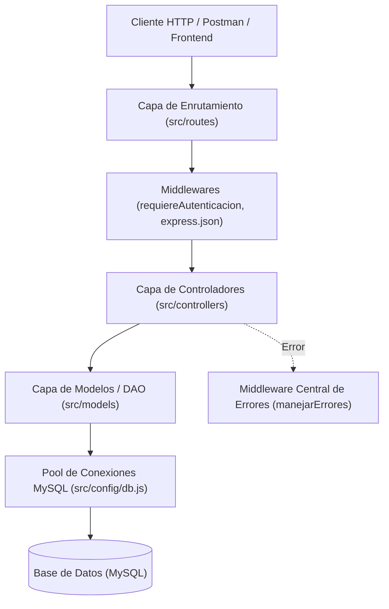
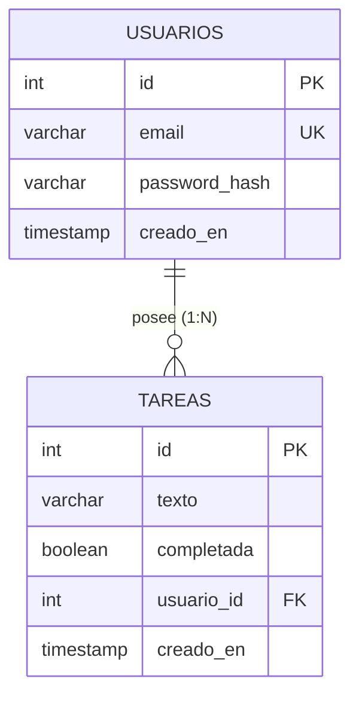

# Resumen del Proyecto: Sistema de Gestión de Tareas

Documento sintético que describe la arquitectura, componentes principales, modelo de datos y endpoints de la API desarrollada para la cátedra de Programación 4.

---

## 1. Descripción General

El proyecto es una **API RESTful stateless** para la gestión concurrente y multiusuario de tareas (*To-Do List*), construida sobre la plataforma **Node.js** con el framework **Express** y persistencia en base de datos relacional **MySQL**.

### Tecnologías Principales
- **Entorno de Ejecución:** [Node.js (v22+)](file:///C:/Users/Pablo%20Bejas/Desktop/Programacion%204/package.json) (utilizando módulos ECMAScript nativos `import`/`export`).
- **Framework Web:** [Express.js (v4.21.2)](file:///C:/Users/Pablo%20Bejas/Desktop/Programacion%204/package.json#L14).
- **Base de Datos:** [MySQL / MariaDB](file:///C:/Users/Pablo%20Bejas/Desktop/Programacion%204/database/schema.sql) mediante el driver [`mysql2/promise`](file:///C:/Users/Pablo%20Bejas/Desktop/Programacion%204/src/config/db.js).
- **Seguridad y Criptografía:**
  - Hashing de contraseñas con [`bcryptjs`](file:///C:/Users/Pablo%20Bejas/Desktop/Programacion%204/src/controllers/auth.controller.js#L1).
  - Autenticación mediante tokens firmados [`jsonwebtoken` (JWT)](file:///C:/Users/Pablo%20Bejas/Desktop/Programacion%204/src/middlewares/requiereAutenticacion.js#L1).
- **Configuración:** Carga de variables de entorno mediante [`dotenv`](file:///C:/Users/Pablo%20Bejas/Desktop/Programacion%204/src/server.js#L1).

---

## 2. Arquitectura del Sistema

El sistema implementa una **Arquitectura en Capas** con separación estricta de responsabilidades:

### Organización del Código
- **Punto de Arranque:** [`server.js`](file:///C:/Users/Pablo%20Bejas/Desktop/Programacion%204/src/server.js) verifica la conectividad con MySQL antes de iniciar el listener HTTP.
- **Configuración de Express:** [`app.js`](file:///C:/Users/Pablo%20Bejas/Desktop/Programacion%204/src/app.js) registra middlewares globales, rutas y el manejador de excepciones.
- **Rutas ([`src/routes/`](file:///C:/Users/Pablo%20Bejas/Desktop/Programacion%204/src/routes)):**
  - [`health.routes.js`](file:///C:/Users/Pablo%20Bejas/Desktop/Programacion%204/src/routes/health.routes.js): Comprobación de estado del servicio y conexión a BD.
  - [`auth.routes.js`](file:///C:/Users/Pablo%20Bejas/Desktop/Programacion%204/src/routes/auth.routes.js): Registro y autenticación de usuarios.
  - [`tareas.routes.js`](file:///C:/Users/Pablo%20Bejas/Desktop/Programacion%204/src/routes/tareas.routes.js): Operaciones CRUD sobre las tareas, protegidas por token.
- **Controladores ([`src/controllers/`](file:///C:/Users/Pablo%20Bejas/Desktop/Programacion%204/src/controllers)):**
  - [`auth.controller.js`](file:///C:/Users/Pablo%20Bejas/Desktop/Programacion%204/src/controllers/auth.controller.js): Lógica de [`registro`](file:///C:/Users/Pablo%20Bejas/Desktop/Programacion%204/src/controllers/auth.controller.js#L5) y [`login`](file:///C:/Users/Pablo%20Bejas/Desktop/Programacion%204/src/controllers/auth.controller.js#L30).
  - [`tareas.controller.js`](file:///C:/Users/Pablo%20Bejas/Desktop/Programacion%204/src/controllers/tareas.controller.js): Acciones de [`listar`](file:///C:/Users/Pablo%20Bejas/Desktop/Programacion%204/src/controllers/tareas.controller.js#L3), [`crear`](file:///C:/Users/Pablo%20Bejas/Desktop/Programacion%204/src/controllers/tareas.controller.js#L26), [`obtenerPorId`](file:///C:/Users/Pablo%20Bejas/Desktop/Programacion%204/src/controllers/tareas.controller.js#L12), [`alternar`](file:///C:/Users/Pablo%20Bejas/Desktop/Programacion%204/src/controllers/tareas.controller.js#L41) y [`eliminar`](file:///C:/Users/Pablo%20Bejas/Desktop/Programacion%204/src/controllers/tareas.controller.js#L55).
- **Modelos / Acceso a Datos ([`src/models/`](file:///C:/Users/Pablo%20Bejas/Desktop/Programacion%204/src/models)):**
  - [`usuarios.model.js`](file:///C:/Users/Pablo%20Bejas/Desktop/Programacion%204/src/models/usuarios.model.js): Consultas SQL parametrizadas a la tabla `usuarios`.
  - [`tareas.model.js`](file:///C:/Users/Pablo%20Bejas/Desktop/Programacion%204/src/models/tareas.model.js): Consultas SQL parametrizadas a la tabla `tareas`.
- **Middlewares ([`src/middlewares/`](file:///C:/Users/Pablo%20Bejas/Desktop/Programacion%204/src/middlewares)):**
  - [`requiereAutenticacion.js`](file:///C:/Users/Pablo%20Bejas/Desktop/Programacion%204/src/middlewares/requiereAutenticacion.js): Valida el JWT de la cabecera `Authorization` e inyecta el usuario decodificado en `req.usuario`.
  - [`manejarErrores.js`](file:///C:/Users/Pablo%20Bejas/Desktop/Programacion%204/src/middlewares/manejarErrores.js): Atrapa excepciones no controladas y devuelve respuestas JSON 500 estándar.

---

## 3. Modelo de Base de Datos

Definido en [`database/schema.sql`](file:///C:/Users/Pablo%20Bejas/Desktop/Programacion%204/database/schema.sql):

- **Restricción de Integridad:** Clave foránea `usuario_id` vinculada a `usuarios(id)` con regla `ON DELETE CASCADE`.
- **Aislamiento Multi-inquilino:** Toda consulta en [`tareas.model.js`](file:///C:/Users/Pablo%20Bejas/Desktop/Programacion%204/src/models/tareas.model.js) filtra estrictamente por `usuario_id = ?`, impidiendo que un usuario acceda o modifique tareas ajenas.

---

## 4. Catálogo de Endpoints

| Método | Endpoint | Autenticación | Descripción |
| :--- | :--- | :---: | :--- |
| `GET` | `/health` | No | Verifica el estado del servidor y la conexión a MySQL |
| `POST` | `/registro` | No | Registra un nuevo usuario con `email` y `password` |
| `POST` | `/login` | No | Valida credenciales y genera el token JWT |
| `GET` | `/tareas` | Sí (JWT) | Lista las tareas del usuario (soporta filtros `?completada=` y `?buscar=`) |
| `GET` | `/tareas/:id` | Sí (JWT) | Obtiene una tarea específica del usuario autenticado |
| `POST` | `/tareas` | Sí (JWT) | Crea una nueva tarea asociada al usuario autenticado |
| `PATCH` | `/tareas/:id` | Sí (JWT) | Alterna el estado de completada de una tarea (`TRUE`/`FALSE`) |
| `DELETE` | `/tareas/:id` | Sí (JWT) | Elimina una tarea propia (devuelve HTTP `204 No Content`) |

---

## 5. Medidas de Seguridad Implementadas

1. **Prevención de Inyección SQL:** Todas las consultas a la base de datos utilizan *Prepared Statements* (sentencias preparadas con placeholders `?`).
2. **Protección de Credenciales:** Las contraseñas se almacenan mediante el algoritmo criptográfico Bcrypt con factor de costo 10; nunca en texto plano.
3. **Autenticación Stateless:** Tokens JWT con expiración de 24 horas, eliminando la necesidad de persistir estados de sesión en memoria RAM del servidor.
4. **Validación de Propiedad (Previsión IDOR):** Las modificaciones y lecturas de tareas validan en el `WHERE` tanto el `id` de la tarea como el `usuario_id` obtenido del token verificado.
5. **Manejo Seguro de Errores:** El middleware centralizado captura fallos imprevistos y oculta trazas internas de ejecución al cliente externo.
